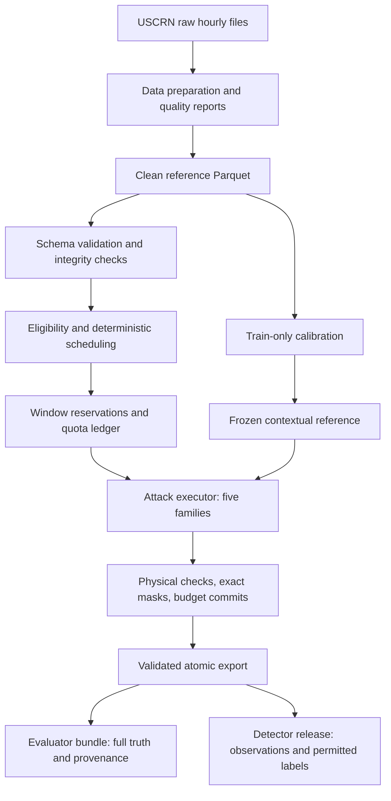
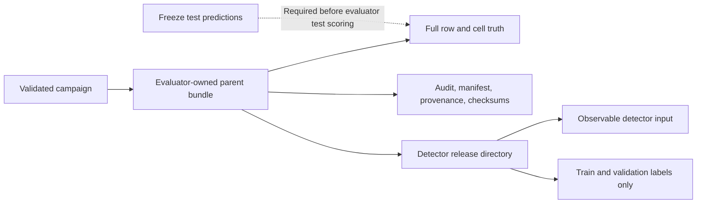

# CIS — Environmental Sensor False Data Injection

**A reproducible research pipeline for generating, validating, and exporting controlled attacks on environmental time series.**

Developed for **TSYP14 · Ground Truth Under Attack · Track 2: False Data Injection**, this repository brings together the USCRN reference delivery and a Python attack engine. It follows the experiment from source-data preparation through coordinated multi-variable attacks to separate evaluator and detector datasets.

**Current implementation:** dataset validation and profiling, deterministic scheduling, five attack families, train-only contextual calibration, multi-variable injection, and validated dataset export. The latest recorded full validation passed **544 tests**, including real-USCRN integration cases. AI benchmarking, ERA5 integration, a Sensor Emulator, and cryptographic signing are outside the implemented scope.

## Contents

- [Implementation history](#implementation-history)
- [Architecture](#architecture)
- [Reference dataset](#reference-dataset)
- [Attack families](#attack-families)
- [Constraints and budget accounting](#constraints-and-budget-accounting)
- [Quick start](#quick-start)
- [Campaign configuration](#campaign-configuration)
- [Export contract and access boundary](#export-contract-and-access-boundary)
- [Validated results](#validated-results)
- [Testing and reproducibility](#testing-and-reproducibility)
- [Repository map](#repository-map)
- [Technical reports and limitations](#technical-reports-and-limitations)

## Implementation history

| Stage | Implemented capabilities | Result |
|---|---|---|
| Research and data delivery | Station selection, four-year availability checks, raw hourly files, cleaning scripts, quality reports, figures, and dataset documentation | A documented environmental reference dataset |
| Phase 1 — Dataset foundation | Explicit schema, Parquet loading, validation profiles, temporal checks, chronological partitions, profiling, and SHA-256 verification | Read-only, validated inputs |
| Phase 2 — Scheduling | Finite-observation eligibility, continuous segments, deterministic window IDs, weighted quota allocation, reservation ledger, and rejection diagnostics | A traceable attack plan |
| Phase 3 — Transformations | Spike, Bias, Drift, and Replay; quantization, exact masks, physical checks, and committed-budget accounting | Controlled in-memory perturbations |
| Phase 4 — Contextual Stealth | Train-only station models, frozen calibration, causal history, contextual projection, and explicit feasibility rejection | A fifth executable family |
| Phase 5 — Export | Audit data, detector input, ground truth, manifest, contract, provenance, checksums, and handover | A versioned downstream dataset bundle |
| Multi-target foundation | Shared per-variable request/result structures, selected targets, changed-variable reporting, and row/cell accounting | Reusable coordination across channels |
| Multi-variable generation | All five families support target subsets and combinations, unit-aware settings, temporal checks, and cross-variable constraints | Five independently validated campaigns |
| Multi-variable export | Exact cell truth, generalized row truth, a separate detector release, and an independent combined campaign | Six real-USCRN export bundles |

The original single-target configuration remains supported. Its seed-14 regression still produces **9,679 modifications**, including **690 Stealth** modifications.

## Architecture



The scheduler decides where an event can occur; transformations propose values; the executor validates and accounts for finalized changes. The exporter consumes the execution results and checks the resulting datasets before publication. Source observations remain unchanged during engine execution and export.

The implementation uses **Python 3.12+**, **uv**, **Pandas**, **NumPy**, **PyArrow**, **Pydantic**, and **PyYAML**, with **Pytest** and **Ruff** for validation. Dependency resolution is recorded in [uv.lock](attack-engine/uv.lock).

## Reference dataset

The committed [USCRN delivery](USCRN_livraison/) includes raw observations, preparation scripts, cleaned CSV/Parquet files, quality summaries, and supporting documents. The engine reads the cleaned Parquet file.

| Property | Reference delivery |
|---|---|
| Source | NOAA/NCEI USCRN hourly observations |
| Coverage | 2022–2025, six stations |
| Shape | 210,384 rows × 23 columns |
| Observation key | Station and hourly timestamp |
| Attackable variables | `SOIL_MOISTURE_5`, `SOIL_MOISTURE_10`, `P_CALC` |
| Other observations | Soil moisture at other depths, soil/air/surface temperature, rainfall, radiation, humidity, and location fields |
| Reference input | `USCRN_livraison/data/uscrn_clean.parquet` |

The six stations are `AZ_Tucson_11_W`, `CA_Fallbrook_5_NE`, `MS_Newton_5_ENE`, `NY_Ithaca_13_E`, `OK_Goodwell_2_E`, and `OK_Goodwell_2_SE`.

Preparation scripts parse the hourly format, construct UTC timestamps, replace missing-value codes, apply available NOAA quality flags, check configured physical ranges, flag vertical moisture inconsistencies, and check temporal continuity. These checks define the supplied experimental reference; they do not establish that every field observation is error-free.

### Chronological partitions

| Partition | Measurement years | Purpose |
|---|---|---|
| Train | 2022–2023 | Context calibration and detector training |
| Validation | 2024 | Development and validation |
| Test | 2025 | Held-out evaluation |

Timestamps mark the **end of the measured hour**. Partition assignment uses the interval start: `start <= time - 1 hour < end`. For example, the record stamped `2026-01-01 00:00 UTC` closes the last hour of 2025 and belongs to test. The rules are explicit in [dataset.yaml](attack-engine/configs/dataset.yaml).

## Attack families

Each family accepts `target_columns`: one variable, a pair, or all three supported variables. The first selected variable supplies the compatibility view used by existing single-target consumers.

| Family | Implemented multi-variable behavior | Key checks |
|---|---|---|
| **Spike** | Synchronized event positions and sign, with a separately configured magnitude for each variable | Final bounds, precision, step limits, and effective changes |
| **Bias** | Coordinated constant offsets across the same window | Bounds and constancy after quantization |
| **Drift** | A shared elapsed-time ramp with independent final magnitudes and slope limits | Realized slopes, temporal continuity, and bounds |
| **Replay** | One earlier, time-aligned historical block across every selected channel | Same station/partition, earlier source, contiguous valid history, and unchanged destination missingness |
| **Stealth** | Train-calibrated contextual rollout with coordinated depth response and bounded rainfall pulses | Context availability, residual band, causal history, rate/step limits, and minimum impact |

`multistealth.py` implements a strategy used by **Stealth**. The registry contains exactly five attack families.

### Contextual calibration

Stealth uses a station-specific standardized ridge reference fitted on **train only**. Its features include environmental context, previous observations, trailing history, and seasonal/hourly encodings. Calibration records feature order, normalization, coefficients, residual tolerances, training boundaries, and input fingerprints.

- Validation and test data do not fit the calibration parameters.
- Generation loads a frozen artifact; it does not silently recalibrate.
- Earlier finalized emissions feed causal attack history.
- Secondary-variable coupling parameters are fitted from train and captured in provenance.
- Missing reference/context or infeasible candidates produce explicit rejections.

This reference model supports attack construction. Detector performance has not been evaluated.

## Constraints and budget accounting

### Physical and numerical rules

| Rule | Enforcement |
|---|---|
| Per-variable units | Independent magnitudes and precision for moisture and rainfall |
| Bounds | Configurable experiment limits; supplied campaigns use moisture `[0, 0.70]` m³/m³ and rainfall `[0, 200]` mm per hourly observation |
| Missing values | Missing observations remain missing and do not become attacked cells |
| Temporal plausibility | Configurable emitted-value steps and offset rates, including contiguous event boundaries |
| Cross-variable relationships | Configurable `lower <= left - scale × right <= upper`, evaluated on values or offsets |
| Exact changes | A modified cell requires finite clean/final values and exact inequality after finalization |
| Conflict prevention | Non-overlapping campaign windows plus executor checks against duplicate cell writes |
| Atomicity | A coordinated event is rejected if any selected variable is infeasible or has no effective change |

The supplied moisture-depth relationship bounds the 5 cm minus 10 cm difference to `[-0.4, 0.4]` m³/m³. These are configurable experimental constraints, not a complete hydrological model. Legacy single-target numerical behavior remains compatible with the baseline.

### Budget semantics

The ledger distinguishes **allocated**, **reserved**, and **committed** capacity. Reservation is planning capacity; commitment counts finalized changes.

| Quantity | Definition |
|---|---|
| Modified rows | Union of rows with at least one changed selected variable |
| Modified cells | Sum of exact changed cells across selected variables |
| Per-variable modifications | Separate changed-cell count for each variable |
| Row budget | Reserve window length; commit the modified-row union |
| Cell budget | Reserve window length × selected-variable count; commit modified cells |
| Quota deficit | Allocated quota minus committed capacity in the configured unit |

The fractional quota is `round_half_up(attack_budget × finite scoped denominator)` in the declared unit. It is not automatically multiplied by the number of channels. Family allocations use weighted largest remainders. Independent `max_modified_rows` and `max_modified_cells` caps apply under both budget policies. Rejections release capacity; constraints are never relaxed just to fill a quota.

## Quick start

Run these commands from the repository root, then work inside `attack-engine`. Install Python 3.12+ and uv first.

```bash
git clone https://github.com/mehdi-lakhzouri/CIS-GRSS.git
cd CIS-GRSS/attack-engine
uv sync --locked
uv run attack-engine --help
```

### Validate and profile

```bash
uv run attack-engine validate --input ../USCRN_livraison/data/uscrn_clean.parquet --json
uv run attack-engine profile --input ../USCRN_livraison/data/uscrn_clean.parquet --json
```

The default dataset configuration is resolved from `configs/dataset.yaml` when available. Validation checks schema, physical ranges, station/time keys, continuity, partitions, reference expectations, and the configured source hash. A generic fixture validation profile is also available; see the [engine CLI reference](attack-engine/README.md).

### Plan or generate a campaign

The following single-line commands work in PowerShell and common Unix shells:

```bash
uv run attack-engine plan --input ../USCRN_livraison/data/uscrn_clean.parquet --config configs/dataset.yaml --attack-config configs/campaigns/combined/scheduling.yaml --json
uv run attack-engine generate --input ../USCRN_livraison/data/uscrn_clean.parquet --config configs/dataset.yaml --attack-config configs/campaigns/combined/scheduling.yaml --attack-params configs/campaigns/combined/attacks.yaml --json
```

`plan` creates reservations without attack values. `generate` computes and reports changes **in memory**, without writing a dataset. Replace `combined` with `spike`, `bias`, `drift`, `replay`, or `stealth` to select an independent campaign.

### Explicit calibration

The reference calibration is included at `calibrations/uscrn_train.json`. To produce a separate artifact explicitly:

```bash
uv run attack-engine calibrate --input ../USCRN_livraison/data/uscrn_clean.parquet --config configs/dataset.yaml --attack-params configs/attacks.yaml --output calibrations/uscrn_train_local.json
```

To use a new artifact, point the chosen attack YAML's `calibration_path` at it. Paths resolve relative to that YAML. Saving refuses to replace different calibration content.

### Export an independent or combined campaign

```bash
uv run attack-engine export --input ../USCRN_livraison/data/uscrn_clean.parquet --config configs/dataset.yaml --attack-config configs/campaigns/combined/scheduling.yaml --attack-params configs/campaigns/combined/attacks.yaml --output datasets/generated
```

Each export creates a new run directory. Existing run IDs are rejected. Prior exports and source observations are preserved.

The reference reproduction driver can export all six campaigns, or a chosen subset:

```bash
uv run python scripts/export_multivariable.py
uv run python scripts/export_multivariable.py --campaigns spike bias
```

**Driver prerequisite:** this script verifies a captured integrity inventory that includes previous local export files. A fresh clone does not include those generated artifacts and may therefore fail its reference-inventory check. Use the general `attack-engine export` command above when those historical local files are unavailable; it supports the same campaign configurations.

| Command | Primary responsibility | Writes |
|---|---|---|
| `validate` | Validate input and integrity | Console output |
| `profile` | Summarize input quality and coverage | Console output |
| `plan` | Allocate quotas and reserve windows | Console output |
| `calibrate` | Fit the train-only reference | Explicit JSON artifact |
| `generate` | Execute in memory and report exact changes | Console output |
| `export` | Execute and publish a validated run | New export directory |

## Campaign configuration

Every directory under [configs/campaigns](attack-engine/configs/campaigns/) contains an `attacks.yaml` and a `scheduling.yaml`. Attack parameters define selected variables and perturbations; scheduling parameters define scope, weights, windows, and budgets.

For example, the supplied [Bias configuration](attack-engine/configs/campaigns/bias/attacks.yaml) expresses magnitudes in each variable's own units:

```yaml
bias:
  magnitude: 0.05                    # First selected variable: m³/m³
  sign: random
  target_columns:
    - SOIL_MOISTURE_5
    - SOIL_MOISTURE_10
    - P_CALC
  secondary_magnitudes:
    SOIL_MOISTURE_10: 0.04           # m³/m³
    P_CALC: 2.0                     # mm
```

This is an excerpt; the complete file also defines bounds, precision, temporal limits, and relationships. Scheduling's `family_parameters.<family>.variable_count` must match the target count. `eligibility_target` controls the finite-observation denominator and defaults to `SOIL_MOISTURE_5`.

The [combined campaign](attack-engine/configs/campaigns/combined/scheduling.yaml) has equal 20% weights across all five families, a cell budget fraction of `0.12`, a **12,433-cell cap**, and a **4,300-row cap**. It runs one shared schedule rather than concatenating independently attacked datasets.

## Export contract and access boundary

**Distribute only the campaign's `detector/` directory to the detector team.** The parent bundle contains clean references, full test ground truth, and private attack details.



| Artifact | Contents | Audience |
|---|---|---|
| `uscrn_attacked.parquet` | Original columns, attacked copies, and audit labels | Evaluator |
| `ground_truth.parquet` | Row truth, exact changes, identities, and evaluability | Evaluator |
| `ground_truth_cells.parquet` | Complete selected-cell truth keyed by station, time, and column | Evaluator |
| `attack_manifest.csv` | Every planned event, including applied/rejected status and accounting | Evaluator |
| `run_provenance.json` | Configuration, calibration, implementation hashes, dependencies, and statistics | Evaluator |
| `data_contract.json` | Schemas, units, target ordering, and audience policy | Audience-specific copy |
| `HANDOVER.md` | Consumption instructions and run context | Audience-specific copy |
| `SHA256SUMS.txt` | Integrity inventory | Bundle-specific copy |
| `detector/detector_input.parquet` | Observable columns with all selected modifications applied | Detector |
| `detector/row_labels.parquet` | Authorized train/validation row labels without value copies | Detector |
| `detector/cell_labels.parquet` | Authorized train/validation cell labels without value copies | Detector |

The parent also includes `detector_input.parquet`, identical to the detector release input. An explicit feature allowlist excludes attack labels, clean-value copies, attacked duplicates, and the clean-derived `flag_incoherence_verticale` flag.

Generalized multi-target exports use contract **2.0**, while the default single-target contract retains **1.0**. Row truth records changed/evaluable columns and all event identities where needed; cell truth includes genuine, missing, and unchanged observations as well as changed cells.

Test observations remain available for predictions, but **test labels are absent from detector releases**. Configuration rejects attempts to include them. Directory separation is a distribution boundary; custodians must retain the evaluator parent. Automated identity controls, prediction freezing, and label-release services are not implemented.

## Validated results

The following are the recorded **23 October 2026, seed-14** real-USCRN export results. Every campaign selects all three supported variables and preserves train observations.

| Campaign | Planned events | Applied | Rejected | Modified rows | Modified cells | Cell quota | Quota deficit |
|---|---:|---:|---:|---:|---:|---:|---:|
| Spike | 308 | 149 | 159 | 266 | 798 | 3,108 | 2,310 |
| Bias | 37 | 19 | 18 | 634 | 1,902 | 3,108 | 1,206 |
| Drift | 24 | 8 | 16 | 264 | 792 | 3,108 | 2,316 |
| Replay | 46 | 15 | 31 | 475 | 1,057 | 3,108 | 2,051 |
| Stealth | 33 | 16 | 17 | 477 | 969 | 3,108 | 2,139 |
| Combined | 356 | 152 | 204 | 1,342 | 3,597 | 12,433 | 8,836 |

| Campaign | 5 cm moisture cells | 10 cm moisture cells | Rainfall cells |
|---|---:|---:|---:|
| Spike | 266 | 266 | 266 |
| Bias | 634 | 634 | 634 |
| Drift | 264 | 264 | 264 |
| Replay | 472 | 468 | 117 |
| Stealth | 477 | 461 | 31 |
| Combined | 1,338 | 1,329 | 930 |

Modified rows are a union; dividing cell counts by three does not recover them. Replay equality, missingness, quantization, and feasibility checks can leave selected cells unchanged. Quota deficits are reported outcomes, not hidden overshoots or forced modifications.

Each three-variable export has **210,384 rows**, **22 detector-input columns**, and **631,152 selected ground-truth cells**. The reference delivery has 210,257 evaluable rows and 618,970 evaluable selected cells. Train changes are **zero** in all six campaigns.

### Artifact location and integrity

The validated local export group is:

```text
attack-engine/datasets/generated/multivariable-20261023-seed14-acb26f07/
  spike/  bias/  drift/  replay/  stealth/  combined/
```

Generated datasets are git-ignored and are **not included in a fresh clone**. The committed [export results](attack-engine/validation/multivariable_export_results.json) contain the recorded statistics and artifact hashes. The [export report](attack-engine/MULTIVARIABLE_EXPORT_REPORT.md) lists all six detector-input checksums and detailed local paths.

| Reference | SHA-256 |
|---|---|
| Source `uscrn_clean.parquet` | `46b98115424bb03af28d31bcb96b68fedd537a609bf97d4199a653a376b98421` |
| Combined `detector_input.parquet` | `ff478b38f2f0996b5301a48f93f0a4b0a40b7bc321440c69f8e85ff31c6eb50a` |

Export validation verified all **65 protected original files**, including the earlier Phase 5 bundle. Writing uses a private staging directory, validation, and atomic publication; existing destinations are rejected. SHA-256 provides content integrity checks, not digital signatures or authentication.

## Testing and reproducibility

The latest recorded complete validation passed **544 tests with zero skips**, including **16 real-data cases**. Ruff lint and formatting checks also passed. These are recorded results for the implemented campaigns, not a live CI badge.

Coverage includes:

- All five families, target subsets, reordered/non-default primary variables, and both budget units.
- Exact cell masks, row unions, per-variable counts, event identities, and quota reconciliation.
- Bounds, missingness, temporal constraints, cross-variable relationships, and atomic rejection.
- Train-only calibration, causal context, no detector leakage, and preserved train/source values.
- Seed reproducibility, deterministic data artifacts, source checksums, corrupted-write rejection, and publication conflicts.
- Each independent campaign and the combined campaign exported twice in integration tests.
- The original seed-14 single-target baseline: Spike 936, Bias 2,798, Drift 2,839, Replay 2,416, Stealth 690.

From `attack-engine`, run the synthetic/default suite and static checks:

```bash
uv run pytest -q
uv run ruff check .
uv run ruff format --check .
```

Enable the real-USCRN cases in PowerShell:

```powershell
$env:ATTACK_ENGINE_REAL_DATASET = (Resolve-Path ../USCRN_livraison/data/uscrn_clean.parquet).Path
uv run pytest -q --tb=short
```

Or in Bash:

```bash
ATTACK_ENGINE_REAL_DATASET="$(pwd)/../USCRN_livraison/data/uscrn_clean.parquet" uv run pytest -q --tb=short
```

Reproduction assumes matching input, parameters, calibration, code, and dependency versions. Data/manifest/contract/release artifacts were checked for deterministic hashes across repeated exports. Run identities and timestamps in provenance/private handovers intentionally vary.

## Repository map

```text
CIS-GRSS/
├── README.md                         # Repository overview and current implementation
├── RESEARCH.md                       # Initial research and design analysis
├── USCRN_livraison/
│   ├── raw/                          # Reference hourly source files
│   ├── scripts/                      # Selection, download, verification, cleaning
│   ├── data/                         # Clean reference data and quality report
│   ├── docs/                         # Dataset/selection/quality documentation
│   └── figures/                      # Reference data visualizations
└── attack-engine/
    ├── configs/                      # Dataset and baseline attack/scheduling YAML
    │   └── campaigns/                # Five independent campaigns plus combined
    ├── calibrations/                 # Frozen train-only reference
    ├── src/attack_engine/
    │   ├── dataset/                  # Schema, loading, temporal rules, validation, profile
    │   ├── scheduling/               # Eligibility, IDs, quotas, ledger, windows
    │   ├── attacks/                  # Five families, multi-target strategies, executor
    │   ├── exporting/                # Builders, contracts, validation, atomic writing
    │   ├── utils/                    # Hashing and integrity utilities
    │   └── cli.py                    # Command-line entry point
    ├── tests/                        # Synthetic and opt-in real-data tests
    ├── scripts/                      # Reference campaign generation/export drivers
    ├── validation/                   # Committed results and integrity inventories
    ├── datasets/generated/           # Local exports; git-ignored
    ├── pyproject.toml
    └── uv.lock
```

## Technical reports and limitations

| Document | What it explains |
|---|---|
| [Research notes](RESEARCH.md) | Initial analysis, threat-model context, and design references |
| [Engine README](attack-engine/README.md) | Detailed original CLI, numerical, calibration, and Phase 5 reference |
| [Phase 3 audit](attack-engine/PHASE3_AUDIT.md) | Primitive attacks, precision regressions, and reconciled counts |
| [Phase 4 report](attack-engine/PHASE4_REPORT.md) | Train-calibrated contextual Stealth |
| [Phase 5 report](attack-engine/PHASE5_REPORT.md) | Original export architecture and validation |
| [Multi-target foundation](attack-engine/MULTI_TARGET_FOUNDATION_REPORT.md) | Shared data models and compatibility foundation |
| [Multi-variable Stealth](attack-engine/MULTIVARIABLE_STEALTH_REPORT.md) | Secondary-variable coordination strategy |
| [All-family report](attack-engine/MULTIVARIABLE_ALL_FAMILIES_REPORT.md) | Current five-family multi-variable behavior and generation evidence |
| [Multi-variable export report](attack-engine/MULTIVARIABLE_EXPORT_REPORT.md) | Current export schema, results, checksums, and validation evidence |

Earlier phase documents describe their implementation stage; the two current multi-variable reports document the later extensions.

The engine currently accepts Parquet input and the three explicitly supported attack variables. Conservative scheduling and physical checks can leave substantial quotas unfilled. Contextual feasibility does not establish that an attack evades a trained detector, and configured relationships do not replace a validated physical simulator.

The repository stops at **attack generation, dataset export, and validation**. It does not yet implement AI detector benchmarking, ERA5 integration, a Sensor Emulator, cryptographic signing, or a hosted API/frontend.
