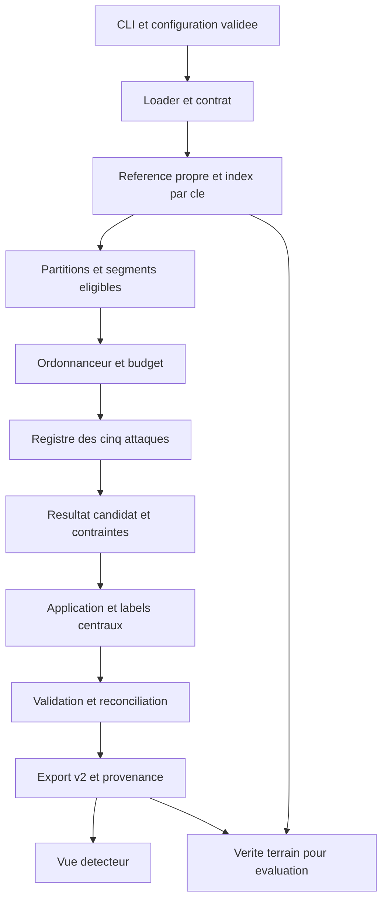
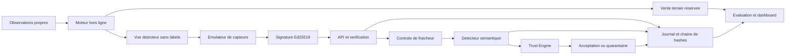

# Attack Engine v2 — Recherche et conception

**Projet :** TSYP14 — Ground Truth Under Attack, Track 2: False-Data Injection.  
**Date de l'étude :** 22 octobre 2026.  
**Périmètre :** recherche, inspection en lecture seule et conception ; aucune implémentation v2.  
**Organisation retenue avec l'utilisateur :** une personne pour le moteur, échanges ponctuels avec l'équipe IA ; document en français, titres et identifiants techniques conservés.

Ce document est l'unique référence de planification. Les fichiers fournis sont des sources à examiner : leurs affirmations ont été confrontées aux données et au code accessibles. Les exigences du challenge issues du PDF sont distinguées des choix de conception du projet.

Convention de lecture : **[V]** observation vérifiée ; **[H]** hypothèse de travail ; **[R]** recommandation de conception ; **[Q]** question ouverte. Les nombres d'audit décrivent les fichiers inspectés et ne constituent pas des performances de détection.

## 1. Executive Summary

**[V] Le socle de données est disponible et cohérent avec la provenance v1.** Le fichier `USCRN_livraison/data/uscrn_clean.parquet` contient **210 384 lignes, 23 colonnes et six stations**, soit 35 064 observations horaires par station. Sa cible `SOIL_MOISTURE_5` comprend 204 983 valeurs finies et 5 401 valeurs manquantes. Son SHA-256 correspond exactement à celui enregistré dans le dépôt de référence. Le CSV local contient les mêmes valeurs après lecture adaptée. Voir sections 3 et 4.

**[V] La v1 préserve les observations originales et ses labels finaux sont corrects sur le livrable inspecté, mais son ordonnancement et sa comptabilité nécessitent une correction.** Le Parquet publié contient 8 904 lignes modifiées, soit **4,3438 % des cibles valides pour 6 % demandés**. Sept paires de fenêtres se chevauchent ; le manifeste additionne 8 958 modifications et référence 106 événements, contre 100 identifiants encore présents dans les labels finaux. Douze événements déclarent trois heures alors qu'ils ne couvrent qu'une observation. Ces constats sont mesurés sur les artefacts publiés, sans réexécuter le moteur.

**[R] Le MVP v2 doit corriger ces invariants avant d'ajouter de la sophistication.** Retenir un package Python simple, cinq transformations indépendantes, un ordonnanceur commun, un budget compté sur les valeurs effectivement modifiées, un manifeste réconcilié et deux vues séparées pour les features et la vérité terrain. Produire des sorties dans un répertoire v2 distinct, sans réécriture de la v1.

**[R] La cinquième attaque sera une falsification conditionnée par le contexte**, fondée sur un petit modèle causal calibré sur une période d'entraînement autorisée. Aucun modèle génératif lourd ni optimisation contre le détecteur final n'est requis dans les dix jours. Les signatures Ed25519, l'API et le Trust Engine restent une intégration ultérieure, avec interfaces décrites ici.

**[Q] La conformité au scénario officiel reste ouverte.** Le PDF exige des datasets officiels et un scénario standard, sans nommer ceux du Track 2. L'utilisateur n'a pas de fiche complémentaire ni de confirmation de l'acceptation d'USCRN. Le prototype proposé est donc un benchmark local documenté ; son statut d'évaluation officielle n'est pas établi.

**Première tâche proposée après autorisation d'implémenter :** formaliser le validateur d'entrée et les régressions sur les sept chevauchements, la borne de fin d'année et le budget, avant de refactorer les générateurs.

## 2. Challenge Context

### 2.1 Exigences vérifiées dans le PDF fourni

**[V]** Le document `Ground Truth Under Attack Securing the Earth Observation Chain.pdf`, deux pages, prévoit un seul track par équipe, cinq membres au maximum et une exécution locale avec ancrage de confiance logiciel ou émulé. Il demande six éléments : modèle de menace, architecture et ancrage de confiance, traitement du signal ou de l'image, détection IA ou statistique, validation adversariale et réponse, documentation utilisant les datasets de référence officiels. [C1]

La première phase est anonyme et comporte rapport, dépôt, prototype et documentation. Le PDF fixe la soumission au **8 novembre 2026**, puis la finale au **11 décembre 2026**. Il annonce une pondération finale de 30 % pour la phase 1 et 70 % pour la phase 2. Ces dates sont celles du fichier fourni ; leur éventuelle mise à jour par les organisateurs n'a pas été vérifiée. [C1]

Pour la phase 1, les critères donnent notamment 20 points à la conception et à l'évaluation du détecteur, 20 au scénario standard et à l'évasion, 15 à l'architecture et à la confiance, 15 au traitement du signal, et 5 à la clarté et à la reproductibilité. **Conséquence de conception :** un moteur d'injection seul ne couvre pas le prototype complet ; il fournit des données et des preuves d'évaluation à la chaîne défensive. [C1]

### 2.2 Positionnement et limites de portée

**[R]** Le segment étudié est la mesure environnementale in situ, représentée par des observations USCRN déjà enregistrées. Le moteur falsifie numériquement la valeur présentée au détecteur ; il ne modifie ni capteur réel ni service externe. Les familles sont des attaques à l'inférence. Une contamination de l'entraînement constituerait un scénario de poisoning distinct, exclu du benchmark principal. Cette distinction suit la taxonomie du [NIST AI 100-2e2025](https://www.nist.gov/publications/adversarial-machine-learning-taxonomy-and-terminology-attacks-and-mitigations-0).

**[H]** Les variables de contexte sont observables par l'attaquant dans le scénario avancé mais restent hors de son contrôle. Cette hypothèse est forte et doit apparaître dans chaque démonstration : plusieurs canaux d'un même capteur compromis pourraient être falsifiés ensemble dans un autre modèle de menace.

**[Q]** À confirmer auprès des organisateurs par l'équipe : dataset officiel du Track 2, définition du scénario commun, attaques et paramètres tenus secrets, règles d'accès au contexte et format de remise. Aucune prise de contact n'a été effectuée dans cette étude.

## 3. Existing Repository Analysis

### 3.1 Sources et méthode

**[V]** Dépôt public inspecté en lecture seule : [RimaArdhaoui/attack-engine](https://github.com/RimaArdhaoui/attack-engine), branche `master`, commit figé **`79c979a337307613ae8872657ef5b795e4e62f58`**, daté du 19 octobre 2026. L'arbre de ce commit comporte dix fichiers. Les huit ressources demandées ont toutes été lues. Le Parquet binaire publié a également été téléchargé **en mémoire** et comparé aux données locales ; le connecteur GitHub est utilisé pour les sources texte et HTTPS pour cette lecture binaire.

| Ressource | Observation vérifiée | Usage pour v2 |
|---|---|---|
| [attack_engine.py](https://github.com/RimaArdhaoui/attack-engine/blob/79c979a337307613ae8872657ef5b795e4e62f58/attack_engine.py) | Script monolithique, version `attack-engine-naive-1.1`, quatre primitives NumPy | Réutiliser les transformations après extraction et correction |
| [data_contract.json](https://github.com/RimaArdhaoui/attack-engine/blob/79c979a337307613ae8872657ef5b795e4e62f58/data_contract.json) | Contrat 1.0, schéma d'entrée, quatre colonnes ajoutées, invariants | Préserver les noms compatibles ; versionner les corrections |
| [verify.py](https://github.com/RimaArdhaoui/attack-engine/blob/79c979a337307613ae8872657ef5b795e4e62f58/verify.py) | Vérifications ad hoc, chemins fixes, relance via subprocess | Transformer les propriétés utiles en tests avec codes d'échec |
| [make_mock.py](https://github.com/RimaArdhaoui/attack-engine/blob/79c979a337307613ae8872657ef5b795e4e62f58/make_mock.py) | Générateur synthétique, six stations, graine 0 | Inspiration pour petites fixtures ; ne pas lancer sur un répertoire contenant les données réelles |
| [HANDOVER_attacked_data.md](https://github.com/RimaArdhaoui/attack-engine/blob/79c979a337307613ae8872657ef5b795e4e62f58/HANDOVER_attacked_data.md) | Guide IA, avertissement contre la cible propre en feature, annonce encore v1.0 | Conserver le principe de séparation ; corriger les garanties temporelles |
| [attack_manifest.csv](https://github.com/RimaArdhaoui/attack-engine/blob/79c979a337307613ae8872657ef5b795e4e62f58/attack_manifest.csv) | 106 événements ; paramètres et statistiques par fenêtre | Conserver la lisibilité CSV ; étendre l'attribution et le suivi du budget |
| [run_provenance.json](https://github.com/RimaArdhaoui/attack-engine/blob/79c979a337307613ae8872657ef5b795e4e62f58/run_provenance.json) | Graine 14, budget 0,06, hashes d'entrée/contrat/sortie | Étendre environnement, configuration normalisée, manifeste et statistiques |
| [README.md](https://github.com/RimaArdhaoui/attack-engine/blob/79c979a337307613ae8872657ef5b795e4e62f58/README.md) | Mode d'emploi et périmètre naïf | Simplifier la future commande et documenter les garanties exactes |

**Limite d'accès :** le rapport `USCRN_livraison/docs/attack_engine_findings.md` mentionné par le README n'est présent ni dans cet arbre GitHub ni dans le workspace inspecté. Son contenu n'a pas été supposé. Aucun environnement de dépendances v1 verrouillé n'est fourni. Aucune réexécution ni mesure de performance de la v1 n'a été effectuée. Aucune licence explicite n'a été trouvée dans l'arbre ; l'autorisation de redistribution du code repris reste à clarifier.

### 3.2 Architecture et déroulement v1

**[V]** `main()` lit les arguments, le Parquet et éventuellement le contrat. `validate_input()` vérifie surtout la présence des colonnes, une cible non entièrement vide et l'unicité de la clé. Les écarts de stations, de nombre de lignes, de taux de nullité et de bornes sont des avertissements. Le contrat absent autorise une exécution sans validation ; `--no-strict` permet aussi de poursuivre malgré des erreurs. Les dtypes, la nullité des clés et la fréquence horaire ne sont pas validés complètement. [R1, fonctions `main` et `validate_input`]

`run()` copie le DataFrame, crée une représentation temporelle interne, trie par station et temps, puis groupe par **année du timestamp UTC**. Il initialise la valeur attaquée à la cible propre et les labels à `0`, `none`, chaîne vide. Pour chaque station-année, il tire une fenêtre pour chaque famille demandée. Les primitives travaillent sur la série propre, puis les résultats sont bornés avec `np.clip`. Seules les positions finies réellement différentes sont écrites et étiquetées. Le script exporte Parquet, manifeste CSV et provenance JSON. [R1, fonction `run`]

### 3.3 Sélection des fenêtres et calcul des amplitudes

Pour un groupe de `N_finite` valeurs valides et un budget `b`, la v1 calcule :

`target_rows = round(b × N_finite)`, puis impose jusqu'à 24 lignes si ce résultat est inférieur à 24. La part par famille est `max(1, target_rows // nombre_de_familles)`.

| Famille v1 | Fenêtre | Transformation avant écrêtage |
|---|---|---|
| `spike` | Six positions, sauf groupe court | 1 à 3 positions finies reçoivent un saut de signe aléatoire et d'amplitude 0,30 m³/m³ |
| `bias` | Longueur égale à la part par famille | Offset constant de ±0,15 sur les positions finies |
| `drift` | Même longueur | Rampe linéaire de 0 à ±0,12, calculée sur le nombre de valeurs finies |
| `replay` | Même longueur | Copie d'une fenêtre propre antérieure de la même station et de la même année UTC, quand source et destination sont finies |

**[V]** Les amplitudes sont des constantes de code, sans calibration climatique ni contrôle du delta final. L'écrêtage réduit certaines perturbations et peut créer une masse artificielle à zéro. `pick_window()` ne réserve pas les fenêtres précédentes. Son tirage avec borne haute exclusive omet le dernier départ admissible. Le replay exclut aussi certains cas de source valides à la limite exacte. Une fenêtre de six positions n'est équivalente à six heures que si la grille d'entrée est continue. [R1, lignes 132–178 et 192–287]

### 3.4 Contrat d'entrée, sortie et préservation

**[V]** Entrée attendue : un enregistrement par `(time, station)`, cible `SOIL_MOISTURE_5`, contexte conservé, six stations. Sortie : toutes les colonnes d'entrée plus `SOIL_MOISTURE_5_attacked`, `is_attacked`, `attack_type`, `attack_id`, soit 27 colonnes dans l'artefact inspecté. La graine pilote un `numpy.random.default_rng` unique ; le hash du fichier d'entrée, le contrat et le hash du Parquet de sortie sont enregistrés. Le manifeste n'a pas de hash enregistré. [R1, R2, R6, R7]

L'audit confirme l'égalité des valeurs des 23 colonnes d'entrée après alignement par clé. Il ne démontre pas une identité binaire des colonnes dans un Parquet réencodé : `Series.equals`, utilisé aussi par `verify.py`, est une comparaison des objets et valeurs chargés. Le tri change potentiellement l'ordre des lignes. Les promesses d'identité binaire inter-environnements et de protection de « tout découpage temporel » sont donc excessives.

### 3.5 Audit indépendant des artefacts publiés

**[V]** Contrôles en mémoire sur le Parquet du commit figé et sur le dataset local :

| Propriété | Résultat vérifié |
|---|---|
| Dimensions de sortie | 210 384 × 27 |
| Colonnes originales préservées après alignement | Oui, les 23 |
| `is_attacked` équivaut à une différence finie cible/sortie | Oui |
| Cible manquante étiquetée attaquée | 0 |
| Valeurs attaquées hors de `[0 ; 0,70]` | 0 |
| Lignes attaquées finales | 8 904 : bias 3 024, drift 3 015, replay 2 820, spike 45 |
| Part des lignes totales / des cibles valides | 4,2323 % / 4,3438 % |
| Budget nominal sur 204 983 cibles finies | Environ 12 299 lignes, avant règles d'arrondi par groupe |
| Somme `rows_changed` du manifeste | 8 958, supérieure de 54 au résultat final |
| Événements déclarés / identifiants actifs finaux | 106 / 100 |
| Paires de fenêtres en chevauchement | 7 |
| Durées déclarées incompatibles avec les timestamps | 12 événements |

Le chevauchement principal concerne `BIA-AZ_Tucson_11_W-2024-0010` et `REP-AZ_Tucson_11_W-2024-0012`, du **11 octobre 2024 à 12:00 UTC au 13 octobre à 11:00 UTC**, soit 48 positions horaires. Le manifeste attribue 121 modifications au biais, mais seules 73 lignes lui restent attribuées dans la sortie finale. Les six autres chevauchements associent spike puis bias sur l'unique observation du 1er janvier 2026 à 00:00 UTC de chaque station. Les six identifiants spike disparaissent des labels ; les douze événements correspondants déclarent trois heures pour une seule position. [R6 et audit de R9]

Les trois hashes suivants correspondent à la provenance publiée :

| Élément | SHA-256 vérifié |
|---|---|
| Parquet propre local, référencé sous `real_uscrn_clean.parquet` en v1 | `46b98115424bb03af28d31bcb96b68fedd537a609bf97d4199a653a376b98421` |
| Contrat du commit inspecté | `6877d101f97eae9b42c6d2f95a230330b97138a3f892c4ccef12c844fd037fc6` |
| Parquet attaqué publié | `f03dbe445f8a4a29e582d2cf39e041036e77d49da50d2c843c259c6e79e9d43a` |

Ce rapprochement vérifie la correspondance entre fichiers inspectés et références v1. Il n'authentifie pas à lui seul l'origine NOAA, la personne ayant produit les artefacts, ni la reproductibilité d'une nouvelle exécution.

## 4. Dataset Analysis

### 4.1 Origine, chaîne de préparation et inventaire

**[V]** Le workspace contient un dossier `USCRN_livraison` avec 24 fichiers bruts `CRNH0203-<année>-<station>.txt`, le Parquet, son CSV, un journal qualité et les scripts de sélection, téléchargement, vérification et nettoyage. Les 24 fichiers bruts totalisent 210 384 lignes. `download_final.py` référence le produit [NOAA/NCEI USCRN Hourly02](https://www.ncei.noaa.gov/pub/data/uscrn/products/hourly02/), six stations et les années 2022–2025. La livraison constitue une sélection et une préparation par l'équipe, pas un produit Parquet officiel NOAA. [D1–D5]

Le script `clean_uscrn.py` parse les 38 champs, construit le temps UTC, convertit les sentinelles en NaN, invalide certaines valeurs selon les drapeaux qualité, applique des bornes, calcule un indicateur vertical, puis trie, déduplique et réindexe chaque fichier annuel. Il retire les drapeaux NOAA des colonnes exportées. Le journal comporte 590 lignes : 463 194 occurrences de sentinelles converties, 420 invalidations de qualité et 7 invalidations hors bornes. Ce sont des décomptes de **cellules**, pas de lignes toutes distinctes. [D2, D4]

**[V]** Les rapports locaux contiennent plusieurs états historiques de sélection : certaines anciennes stations ont été remplacées. Le PDF de livraison annonce par endroits 22 colonnes et le rapport de nettoyage « 23 colonnes utiles + 1 drapeau » ; le fichier réel et la liste d'export du script donnent **23 colonnes au total, drapeau compris**. Les données et le script priment pour le schéma observé.

### 4.2 Format et schéma observés

Le Parquet fait **3 753 138 octets**. Le CSV fait 28 924 436 octets ; son SHA-256 est `06be73a338b79f50ded3a86eb3890699ed08d260ade86e64c7c4f7ebbb84e3d4`. Le CSV relu avec conservation de la précision numérique donne les mêmes valeurs que le Parquet.

| Champs | Type physique Arrow constaté | Rôle et nullité constatée |
|---|---|---|
| `time` | `timestamp[us]`, **sans timezone** | Clé temporelle, aucun null |
| `station` | `large_string` | Six identifiants, aucun null |
| `annee` | `int64` | Année du fichier source / de l'heure mesurée, aucun null |
| `LATITUDE`, `LONGITUDE` | `double` | Métadonnées, aucun null |
| `SOIL_MOISTURE_5` | `double` | Cible m³/m³ ; 5 401 nulls |
| `SOIL_MOISTURE_10/20/50/100` | `double` | Contexte vertical ; 5 335 / 73 028 / 72 949 / 73 873 nulls |
| `SOIL_TEMP_5/10/20/50/100` | `double` | Contexte thermique ; 3 675 / 3 706 / 72 949 / 72 977 / 72 994 nulls |
| `T_HR_AVG`, `T_MAX`, `T_MIN`, `SUR_TEMP` | `double` | Températures de contexte ; 1 116 / 1 036 / 1 029 / 150 nulls |
| `P_CALC`, `SOLARAD`, `RH_HR_AVG` | `double` | Pluie, rayonnement, humidité relative ; 1 446 / 150 / 150 nulls |
| `flag_incoherence_verticale` | `bool` | Indicateur dérivé de données propres ; 210 384 valeurs fausses |

Le contrat v1 annonce `datetime64[ns, UTC]`, alors que le schéma physique est `timestamp[us]` sans fuseau. La lecture de cette étude emploie Python 3.12.13, Pandas 3.1.0, NumPy 2.5.4 et PyArrow 26.0.0 ; ce ne sont pas les versions de génération v1, qui sont inconnues. Le type Pandas affiché dépend de la bibliothèque ; la constatation sur le type Arrow est indépendante de cet affichage.

### 4.3 Temps et frontières

**[V]** La série va du **1er janvier 2022 à 01:00 UTC** au **1er janvier 2026 à 00:00 UTC**, bornes incluses. Aucune clé dupliquée, aucun temps nul et aucun pas différent d'une heure entre observations consécutives d'une même station n'ont été trouvés.

Le [README officiel Hourly02](https://www.ncei.noaa.gov/pub/data/uscrn/products/hourly02/readme.txt) précise que l'horodatage est celui de la fin de l'heure et que LST désigne l'heure standard locale, sans changement saisonnier. `P_CALC` est un cumul en mm sur l'heure, et non une mesure instantanée de débit. **[R]** Documenter `unit: mm`, `aggregation: hourly_sum` ; l'abréviation mm/h ne doit pas conduire à intégrer une seconde fois cette valeur.

`clean_uscrn.py` construit une date UTC puis retire le fuseau avec `tz_localize(None)`. **[R]** Conserver cette colonne source sans transformation dans la sortie compatible, mais utiliser une copie interne explicitement localisée en UTC. Aucune conversion en heure de Lagos ou en heure locale d'exécution ne doit intervenir dans le calcul scientifique.

**[V]** `annee` diffère de l'année du timestamp UTC sur **24 lignes**, les minuits de début d'année. Elle correspond sur toutes les lignes à `year(time_utc - 1 heure)`. Les six lignes du 1er janvier 2026 ferment donc les six dernières heures de 2025 dans cette convention de partition UTC. Elles ne sont pas des données à supprimer. La formulation du contrat v1 « dernière heure de 2025 local » est imprécise : il faut décrire l'intervalle UTC représenté, sans le confondre avec une année civile locale.

**[R]** Définir `interval_start = time_utc - 1 heure` et `observation_year = year(interval_start)` en interne. Découpage recommandé, cohérent avec le rapport de livraison :

| Partition | Années d'observation | Condition sur la fin d'heure UTC | Nombre de lignes |
|---|---|---|---:|
| Train | 2022–2023 | `2022-01-01T00:00Z < time <= 2024-01-01T00:00Z` | 105 120 |
| Validation | 2024 | `2024-01-01T00:00Z < time <= 2025-01-01T00:00Z` | 52 704 |
| Test | 2025 | `2025-01-01T00:00Z < time <= 2026-01-01T00:00Z` | 52 560 |

Ce choix doit être confirmé par l'équipe IA avant export v2. Les frontières réellement configurées, y compris une éventuelle coupure en milieu d'année, gouvernent l'ordonnancement. Aucun argument fondé sur l'année seule ne protège un découpage arbitraire. Pour des séquences d'apprentissage, prévoir une purge liée à leur horizon et exclure les fenêtres de labels qui traversent la coupure ; des features strictement causales peuvent utiliser un historique antérieur autorisé. Le paramètre `gap` de [TimeSeriesSplit](https://scikit-learn.org/stable/modules/generated/sklearn.model_selection.TimeSeriesSplit.html) illustre cette séparation, mais il ne faut pas appliquer aveuglément un découpage par positions à un panel de plusieurs stations.

### 4.4 Cible, valeurs manquantes et contraintes

| Station | Lignes | Cibles manquantes | Part manquante | Min–max observé, m³/m³ |
|---|---:|---:|---:|---|
| `AZ_Tucson_11_W` | 35 064 | 841 | 2,3985 % | 0,012–0,275 |
| `CA_Fallbrook_5_NE` | 35 064 | 11 | 0,0314 % | 0,113–0,349 |
| `MS_Newton_5_ENE` | 35 064 | 14 | 0,0399 % | 0,054–0,409 |
| `NY_Ithaca_13_E` | 35 064 | 727 | 2,0734 % | 0,098–0,523 |
| `OK_Goodwell_2_E` | 35 064 | 3 432 | 9,7878 % | 0,009–0,512 |
| `OK_Goodwell_2_SE` | 35 064 | 376 | 1,0723 % | 0,068–0,499 |

**[V]** Globalement, 5 401 cibles sont manquantes, soit environ 2,5672 %. Aucune cible infinie ni hors de `[0 ; 0,70]` n'est présente ; l'étendue observée est `[0,009 ; 0,523]`. Les six canaux profonds, humidité et température à 20/50/100 cm, sont entièrement vides à Tucson et Fallbrook. L'absence structurelle d'une sonde doit être distinguée d'une interruption ponctuelle.

Le format NOAA emploie notamment `-99` pour l'humidité et `-9999` pour les températures ; les scripts locaux traitent aussi `-99999` pour le rayonnement. Les [mesures USCRN](https://www.ncei.noaa.gov/access/crn/measurements.html) sont des observations instrumentales, avec profondeurs disponibles selon le site et conversion diélectrique en teneur volumique. Les bornes `[0 ; 0,70]` sont **une règle du contrat et du nettoyage local**, pas une garantie universelle décrivant tous les sols.

**[V]** À Ithaca, 701 des 727 heures de cible manquante coïncident avec une température à 5 cm sous 1 °C ; 324 sur 376 à Goodwell 2_SE et 698 sur 3 432 à Goodwell 2_E. Cette association reproduit le constat des rapports, sans prouver la cause de chaque absence. Il existe aussi 1 315 lignes avec cible disponible et pluie manquante. **[R]** Ne jamais interpréter ces pluies manquantes comme une absence de pluie.

**[R]** Les attaques du MVP préservent les masques de valeurs manquantes et n'inventent pas de mesures dans les trous. Ce choix limite le scénario étudié ; un attaquant pourrait fabriquer une télémétrie à une heure sans observation réelle, mais cela exige un scénario séparé. Les fenêtres continues sont découpées aux trous de cible pour bias/drift/replay/stealth ; le spike peut cibler une observation finie isolée. Un contexte insuffisant fait rejeter une candidate stealth ou désactive explicitement une contrainte facultative, avec motif enregistré.

### 4.5 Intégrité, vérité terrain et limites scientifiques

**[R]** Le Parquet propre sert de référence expérimentale immuable. Une copie de travail ne devient pas une vérité physique absolue : erreurs résiduelles, corrections NOAA, effets de gel et limites instrumentales restent possibles. Le hash v1 fournit une référence commune entre équipes ; aucun hash historique authentifié des 24 fichiers NOAA n'a été fourni. Les fichiers distants n'ont pas été retéléchargés pour comparaison à leur état actuel. Le pipeline de nettoyage n'a pas été réexécuté ; sa reproductibilité complète reste à vérifier sans écriture sur la livraison.

Risques de fuite ou de surévaluation à documenter :

- `SOIL_MOISTURE_5` propre, deltas, labels, paramètres et positions des attaques ne doivent jamais devenir des features du détecteur.
- Le drapeau vertical est calculé sur la cible propre. Même constant aujourd'hui, il doit être exclu de la vue détecteur ou recalculé causalement à partir des seules valeurs observables.
- Les rapports de sélection utilisent notamment la disponibilité de 2025, année destinée au test, et le seuil spatial de livraison exploite une période non isolée. Ces choix introduisent une sélection rétrospective ; ne pas présenter le test comme totalement indépendant de la préparation du dataset.
- Les statistiques globales de cette étude sont descriptives. Ne pas reprendre leurs quantiles ou seuils pour calibrer le modèle final. Ajuster imputation de contexte, normalisation, profils saisonniers et seuils sur train autorisé ; régler les hyperparamètres sur validation ; figer avant test.
- Une paire de stations à 3,8 km ne mesure pas nécessairement le même sol. Le décalage de 0,056 m³/m³ et le seuil de 0,095 annoncés dans le rapport sont des résultats de ce rapport, à recalibrer sur train ; ils ne prouvent ni équivalence des sites ni garantie de fausse alarme.
- Une variation à 5 cm sans réponse immédiate à 10 cm peut être naturelle. Les règles de cohérence sont des indices statistiques, avec retards d'infiltration et incertitudes, et non des lois d'impossibilité.
- Six stations américaines, quatre années et des attaques synthétiques ne démontrent pas une généralisation à d'autres sols, à la Tunisie ou à une infrastructure opérationnelle. Le contrôle spatial direct n'est disponible que pour Goodwell.

## 5. Existing Engine Limitations

| Priorité | Limitation vérifiée dans le code ou l'artefact | Conséquence | Correction recommandée |
|---|---|---|---|
| P0 | Fenêtres tirées indépendamment, sans réservation | Dernière écriture prioritaire, manifeste divergent | Ordonnanceur avec occupation par station/cible et validation finale |
| P0 | Budget traduit en longueur de fenêtre ; spike ne change que 1–3 points | Sous-consommation importante ; parts des familles déséquilibrées | Compter les changements finaux et planifier plusieurs événements |
| P0 | Budget inférieur à 24 remplacé par un minimum | `budget=0` peut encore injecter ; budget négatif accepté dans `run` | Valider `[0 ; 1]`, zéro donne zéro, aucun minimum caché |
| P0 | Longueur minimale 3 réappliquée à un groupe d'une ligne | Fausses durées sur les six dernières observations | Conserver la longueur réelle ; fusionner ces heures dans leur année d'observation |
| P0 | Année UTC utilisée, sans frontières de split configurables | Ne protège pas une coupure au milieu d'année | Partitions explicites construites avant l'injection |
| P0 | Contrat optionnel et validations de type/nullité incomplètes | Entrée impropre acceptée, échec tardif | Validation stricte par défaut et refus avant tout export |
| P1 | Drift calculé sur le compte de valeurs finies | Vitesse différente selon les trous | Rampe fondée sur le temps écoulé ou rejet des fenêtres trouées |
| P1 | Replay sans identifiants de source dans le manifeste | Difficile de reproduire une substitution précise | Source, durée, ancienneté et hash de valeurs référencés |
| P1 | Écrêtage global, amplitudes fixes | Biais perd sa constance ; artefacts de saturation | Faisabilité par famille ; enregistrer deltas réels et saturation |
| P1 | Bornes de tirage exclusives mal ajustées | Derniers départs et certaines sources exclus | Tests des deux extrémités des ensembles candidats |
| P1 | Liste d'attaques vide ou dupliquée non validée | Division par zéro ou injections répétées | Configuration typée et validation des doublons |
| P1 | `verify.py` ignore le code de retour du subprocess et n'échoue pas explicitement en fin de contrôle | Faux succès en automatisation ; risque de relire une ancienne sortie | Pytest, chemins temporaires, échec non nul et vérification des fichiers frais |
| P1 | Graine seule, sans versions d'environnement | Reproductibilité plus faible que promise | Dépendances verrouillées, RNG nommé, configuration normalisée |
| P1 | `make_mock.py` écrit `uscrn_clean.parquet` dans le dossier courant | Risque d'écrasement accidentel lors des essais | Fixtures temporaires de taille réduite, noms distincts |

**Points à conserver :** transformations vectorisées simples, séparation propre/attaqué, masque fini, labels de changement effectif, contrat partagé, hash d'entrée, manifeste lisible et graine explicite. **À refondre :** ordonnancement, budget, validation et export. Les primitives peuvent être adaptées sans conserver le script monolithique. L'absence de licence explicite doit être résolue avant redistribution du code repris.

## 6. Attack Engine v2 Objectives

**[R] Objectifs P0 :**

1. Lire et valider la livraison sans la modifier ; préserver clés, valeurs, dtypes source et masques de nullité.
2. Définir les splits avant toute attaque ; interdire les frontières configurées, les changements de station et les trous non autorisés.
3. Produire cinq familles indépendantes ; centraliser les labels, le budget et les contrôles.
4. Interdire les chevauchements dans le MVP, sur la fenêtre réservée entière même pour un spike clairsemé.
5. Enregistrer budget demandé, obtenu, faisable et déficit motivé ; aucune sous-consommation silencieuse.
6. Réconcilier chaque événement accepté avec les lignes finales et empêcher la fuite de vérité terrain.
7. Obtenir une reproductibilité de contenu dans un environnement verrouillé et tracer les hashes.
8. Exporter vers `outputs/v2/<run_id>/` sans écrasement d'une exécution existante ni de la v1.

**[R] Objectifs P1 :** contexte causal simple pour stealth, calibration sur train, profils de difficulté, tests d'intégration avec l'équipe IA, mesures de ressources du moteur. **P2 :** streaming, signatures, API, composition d'attaques, scénarios multicibles et optimisation contre un modèle substitut.

Le MVP reste un outil hors ligne en mémoire pour environ 210 000 lignes. Un système de plugins externe, un orchestrateur distribué, des microservices, une base de données et un réseau neuronal génératif ne sont pas nécessaires.

## 7. Detailed Attack Research

### 7.1 Modèle commun et portée adversariale

**[R]** Noter `x[s,t]` la cible propre, `y[s,t]` la valeur présentée au détecteur, `c[s,t]` le contexte accessible, et `W` une fenêtre d'une station dans une partition autorisée. L'attaquant modifie uniquement le canal 5 cm dans une copie ; il n'accède en écriture ni au contexte ni aux labels. Les labels sont calculés par l'évaluateur après l'attaque.

L'ordonnanceur hors ligne peut examiner une fenêtre complète pour en vérifier l'éligibilité. Cette connaissance rétrospective doit être distinguée des entrées causales utilisées par un générateur à chaque instant : un benchmark sur fichiers ne démontre pas à lui seul la faisabilité d'une attaque en streaming sans connaissance du futur. Une future démonstration en ligne devra limiter aussi la sélection des fenêtres et les contrôles de faisabilité aux informations alors disponibles.

Pour une cible finie, la contrainte de sortie est `0 <= y <= 0,70`. Une cible NaN reste NaN. Définir le masque final :

`changed[s,t] = finite(x[s,t]) AND finite(y[s,t]) AND (y[s,t] != x[s,t])`.

La comparaison porte sur les valeurs réellement exportées. Les paramètres d'attaque doivent éviter les deltas subnumériques ; un quantum optionnel de 0,001 m³/m³, cohérent avec la précision textuelle des observations, sera explicite dans la configuration. La quantification est appliquée aux valeurs candidates modifiées, jamais aux observations propres ni à toute la colonne indistinctement. Une candidate devenue identique après quantification n'est pas étiquetée attaquée.

Deux profils expérimentaux : **naïf**, avec amplitudes comparables à la v1 et écrêtage tracé lorsqu'il fait partie du profil ; **contraint**, avec faisabilité vérifiée avant acceptation et sans saturation cachée. Les fourchettes ci-dessous sont des **paramètres proposés**, non des seuils officiels ni des résultats calibrés.

Les travaux d'[Erba et al., ACSAC 2020](https://arxiv.org/abs/1907.07487) montrent, dans des systèmes industriels, que la cohérence entre variables et les capacités limitées de l'attaquant influencent l'évasion. **Inférence de conception :** une valeur historique réelle ou dans les bornes n'est pas nécessairement cohérente avec le contexte actuel. Les résultats de ces systèmes ne sont pas transposés numériquement à USCRN.

### 7.2 Attack 1 — Spike Injection

**Objectif et menace.** Simuler une erreur volontaire brève de mesure, un faux événement hydrique ou une falsification ponctuelle du flux avant détection. Capacité : écriture de quelques valeurs du canal cible ; connaissance limitée au signal courant et aux paramètres du test. Point d'injection : tableau cible de travail.

**Entrées et paramètres.** Fenêtre de 1 à 6 heures, positions choisies sans remise, 1 à 3 impacts par événement, signe et amplitude `a`. Proposition initiale : amplitudes 0,02–0,30 m³/m³, avec 0,30 pour le profil comparable à v1. Pour `I`, ensemble des positions ciblées :

`y_t = x_t + sign × a_t` si `t ∈ I`, sinon `y_t = x_t`.

**Contraintes et effet attendu.** La version contrainte choisit signe/amplitude admissibles pour les points ciblés. Le profil écrêté utilise `clip(x_t + sign × a_t, 0, 0,70)` et indique la perte d'amplitude. Ne pas imposer au profil naïf une faible dérivée qui annulerait précisément son caractère abrupt. Un spike peut rester dans les bornes tout en contredisant la pluie ou les autres profondeurs.

**Détection possible.** Dérivées robustes, filtre de Hampel causal, résidu de prédiction à un pas, cohérence pluie/profondeur. Une vraie averse doit figurer parmi les cas normaux difficiles.

**Mesures moteur.** Points demandés/obtenus, delta absolu, signe, saturation, taille du support. **Mesures détecteur.** Recall ponctuel, FPR autour des pluies naturelles, latence d'une observation et précision. Aucun taux n'est présumé.

**Cas limites et limites.** Fenêtre trop courte, cible NaN, valeur proche d'une borne, absence de pluie disponible, impacts adjacents ressemblant à un biais bref. Une seule observation horaire ne modélise pas des pointes subhoraires.

**Tests unitaires proposés.** Nombre exact de positions réellement changées, absence de remise, signes, bornes, non-mutation, NaN, amplitude nulle et effet de quantification. **Intégration.** Plusieurs spikes dans un groupe, budget respecté par le total d'impacts, fenêtres réservées distinctes et épisode naturel pluvieux conservé comme témoin.

### 7.3 Attack 2 — Bias Injection

**Objectif et menace.** Simuler une calibration volontairement décalée et maintenir une estimation hydrique erronée. Capacité : modification continue de la cible pendant un épisode, contexte inchangé ; injection dans la copie du dataset.

**Entrées et transformation.** Fenêtre initiale proposée de 6 à 168 heures, biais signé `b`, amplitudes candidates 0,01–0,15 m³/m³ :

`y_t = x_t + b`, pour `t ∈ W`.

Pour conserver un biais constant sans écrêtage, choisir :

`b ∈ [max_t(0 - x_t), min_t(0,70 - x_t)]`, sur les valeurs finies de `W`, avec `b != 0` après matérialisation.

**Effet et plausibilité.** Décalage de niveau, forme locale conservée. L'admissibilité est vérifiée sur toute la fenêtre. Un profil reproduisant v1 peut écrêter, mais doit être nommé `bias` avec `clipped=true` et préciser que le delta réalisé n'est plus constant. Pour le MVP contraint, préférer un nouveau tirage réalisable.

**Détection possible.** Résidu de niveau à 10 cm, comparaison Goodwell après calibration, EWMA/CUSUM de résidus, modèle contextuel. Évaluer aussi la fin d'épisode, qui peut produire un saut de retour.

**Mesures moteur.** Biais demandé et réalisé, MAE induite, durée, saturation. **Mesures détecteur.** Recall par point et événement, FPR, délai jusqu'à première alerte ; score par signe et amplitude.

**Cas limites et limites.** Fenêtre contenant des NaN, biais nul, intervalle admissible trop étroit, niveau naturellement saisonnier, longue durée confondue avec changement de régime. Une erreur de calibration réelle reste une anomalie sémantique possible sans être une cyberattaque.

**Tests unitaires.** Delta constant sans écrêtage, faisabilité aux bornes, signe négatif, NaN conservés, refus de biais nul effectif. **Intégration.** Fenêtre entièrement dans une partition et un segment continu, manifeste reconstruit depuis la sortie, comparaison témoin et profil v1 clairement distincte.

### 7.4 Attack 3 — Slow Drift

**Objectif et menace.** Accumuler une erreur tout en évitant un seuil sur la variation instantanée. Capacité : contrôle persistant d'un canal avec mémoire temporelle ; injection locale avant calcul des features.

**Entrées et transformation.** Fenêtre proposée de 24 à 336 heures, amplitude finale signée `A` de 0,01–0,12 m³/m³ et pente maximale configurée. Pour des timestamps `t_0 ... t_last` :

`r_t = (t - t_0) / (t_last - t_0)` ; `y_t = x_t + A × r_t`.

Il faut au moins deux timestamps distincts. La pente additionnelle est `abs(A) / durée_écoulée`, en m³/m³ par heure. Le premier point de rampe est inchangé et conserve un label 0 ; la durée de fenêtre reste distincte du nombre de points modifiés. Une rampe retour peut devenir un profil ultérieur ; le retour abrupt du MVP doit être visible dans son manifeste.

**Contraintes et effet.** Faisabilité des bornes sur chaque position, contrôle de la pente injectée et progression en temps réel. Le MVP rejette une fenêtre traversant des trous ; une future variante utilisant des fenêtres incomplètes calculera malgré tout la pente sur le temps écoulé, jamais sur le rang des seules valeurs finies.

**Détection possible.** CUSUM/EWMA sur résidus, tests de rupture, résidus de longue durée, cohérence avec profondeur et voisin. Un seuil de dérivée seul peut être peu sensible : c'est une hypothèse à évaluer.

**Mesures moteur.** Amplitude finale réelle, pente, aire de `abs(y-x)` intégrée dans le temps, points changés. **Mesures détecteur.** Délai en heures, recall par amplitude/pente, événements détectés avant l'erreur maximale, FPR pendant les assèchements naturels.

**Cas limites et limites.** Longueur 1, plateau créé par quantification, saturation, trous, fenêtre de fin de split, retour final révélateur. La lenteur ne garantit pas l'évasion d'un détecteur cumulatif.

**Tests unitaires.** Premier point non attaqué, amplitude terminale, pente temporelle, quantification et plateau, cas longueur 1 refusé. **Intégration.** Aucun franchissement de split, budget fondé sur les seuls changements effectifs, tests à l'année bissextile et au minuit du 1er janvier.

### 7.5 Attack 4 — Historical Replay

**Objectif et menace.** Masquer une évolution actuelle par une séquence historiquement authentique. Capacité : lecture d'un historique antérieur de la même station et écriture du canal courant, sans accès en écriture aux autres variables.

**Entrées et transformation.** Fenêtre cible `W = (t_0 ... t_{L-1})`, source `S = (u_0 ... u_{L-1})`, longueur proposée 6–168 heures, grille horaire identique, ancienneté minimale d'au moins la durée de fenêtre :

`y[t_i] = x[u_i]` avec `u_last < t_0`.

La source est l'historique **propre immuable**, jamais une sortie déjà attaquée. Dans le MVP, source et cible doivent appartenir à la même station et à la même partition autorisée ; l'option de source issue d'un train antérieur est exclue du profil test par défaut pour éviter une copie de motifs vus par le modèle. Une extension pourra l'autoriser explicitement en distinguant ce protocole dans les résultats.

**Contraintes et effet.** Fenêtres source/cible complètes, pas horaire, valeurs finies ; aucune retouche des timestamps, de la pluie ou des profondeurs. Un source/cible identique sur certaines positions n'y produit pas de label d'attaque. Rejeter un événement entièrement sans effet. Enregistrer clés source, bornes, ancienneté, mode de sélection et hash de la séquence source.

**Distinction essentielle.** Le replay de dataset substitue des valeurs puis peut les emballer dans une **nouvelle** télémétrie avec séquence et temps d'émission actuels. L'anti-replay réseau peut donc l'accepter. Le replay réseau retransmet un ancien paquet signé avec son ancienne séquence ou son nonce : c'est un contrôle de fraîcheur distinct, décrit en section 11.

**Détection possible.** Correspondance répétée de motifs, résidus de contexte pluie/profondeur, incohérences aux raccords, dérive temporelle. Le fait que chaque valeur source ait été réelle ne garantit pas sa plausibilité au temps cible.

**Mesures moteur.** Ancienneté, taux d'égalité source/cible, points effectivement changés, distance au contexte. **Mesures détecteur.** Recall par événement, FPR sur séquences naturellement stables, délai et évasion par saison.

**Cas limites et limites.** Pas d'historique au début d'une partition, source trouée, longueur trop grande, répétitions naturelles de valeurs arrondies, source autorisée exactement à la dernière position admissible. Une copie univariée laisse les corrélations multivariées intactes du côté contexte, ce qui peut faciliter la détection.

**Tests unitaires.** Source strictement antérieure, même station, fin exacte de source admissible, égalités non étiquetées, NaN source/cible rejetés, absence d'historique. **Intégration.** Source et cible dans les partitions autorisées, restitution exacte à partir du manifeste, aucune lecture d'un fichier attaqué comme source.

### 7.6 Attack 5 — Context-Aware Stealth Injection

**Objectif et menace.** Induire une erreur mesurable tout en respectant des relations contextuelles simples, pour évaluer les limites d'un détecteur naïf. Capacité : accès au passé et au contexte courant autorisé, contrôle du seul canal 5 cm, éventuellement connaissance de règles générales. Aucun accès aux prédictions du détecteur final dans le MVP.

**Entrées et calibration.** Cible, pluie courante et cumuls causaux, humidité 10 cm, températures, saison, éventuellement voisin Goodwell ; fenêtre proposée 12–168 heures. Le modèle contextuel minimal est une régression régularisée simple ou un estimateur robuste léger, ajusté hors du moteur de génération puis chargé comme petit artefact versionné. NumPy suffit pour une première régression linéaire régularisée ; scikit-learn reste facultatif pour ce composant.

Pour une configuration avancée valid/test, figer `f_train` et une enveloppe de résidus calibrés sur **train uniquement**. Pour des attaques générées dans train, utiliser un préfixe de calibration antérieur et une zone d'injection ultérieure, ou une procédure chronologique interne. Ne pas entraîner `f` sur tout 2022–2023 pour prétendre simuler un attaquant strictement causal au début de 2022.

**Transformation proposée, avec ensemble de faisabilité explicite.**

`mu_t = f_train(c_<=t, historique_observable_<t)`.

Construire `F_t`, intersection de `[0 ; 0,70]`, d'une bande `mu_t ± k × sigma_train`, d'une contrainte de variation temporelle calibrée et d'une tolérance profondeur/voisin lorsqu'ils sont disponibles. Générer ensuite une cible souhaitée `x_t + d_t`, où `d_t` est une perturbation lisse et signée, puis :

`y_t = projection_sur_F_t(x_t + d_t)`.

Cette utilisation de `x_t` décrit le capteur qui connaît sa mesure avant de la falsifier. Les lags du canal cible dans le modèle de contexte utilisent le flux déjà émis `y_<t` pendant l'attaque, pas un accès du détecteur à l'historique propre caché. Une variante d'évaluation avec accès complet au propre doit être annoncée comme oracle hors ligne.

**Paramètres et contraintes.** Amplitude désirée initiale 0,005–0,05 m³/m³, pente, largeur d'enveloppe `k`, historique minimal, couverture du contexte et nombre maximal d'essais. Ces valeurs sont à calibrer sur train/validation, sans tuning sur test. Une pluie inconnue n'est jamais assimilée à zéro. La réponse à une pluie n'impose pas une humidification immédiate à toutes les profondeurs ; prévoir retards et tolérances plutôt qu'une règle absolue.

Si `F_t` est vide, si le contexte requis est absent ou si le delta obtenu est inférieur au minimum utile configuré, rejeter la candidate avec motif ; ne pas relâcher silencieusement les contraintes pour consommer le budget. Un événement doit modifier au moins une observation et atteindre un seuil d'impact déclaré, faute de quoi un succès d'évasion sur des perturbations insignifiantes serait trompeur.

**Effet et limites.** Des valeurs localement plausibles peuvent déplacer le niveau ou masquer une recharge. Cela ne prouve ni cohérence hydrologique complète ni évasion d'un modèle plus riche. La projection peut aplatir les deltas ou rendre certaines périodes inattaquables ; le manifeste doit l'exposer. Le contexte USCRN n'est pas un simulateur de bassin versant.

**Détection possible.** Ensemble de résidus sur plusieurs horizons, contrôle spatial indépendant, détection de rupture, diversité de modèles et changements de confiance. **Mesures moteur.** Faisabilité, couverture de contexte, deltas réalisés, contraintes satisfaites, impact cumulé, rejets et coût de génération. **Mesures détecteur.** Évasion conditionnée à un impact minimal, FPR, délai, comparaison avec une attaque naïve de même budget et même impact.

**Tests unitaires.** Projection dans l'intersection, intersection vide, pluie NaN, profondeur structurellement absente, estimation causale, lags attaqués, hash de calibration, effet nul rejeté. **Intégration.** Artefact de calibration issu du seul train, aucune consultation des scores test, reproductibilité et rapport séparant faible impact d'évasion réelle.

### 7.7 Stratégie d'évasion et protocole de comparaison

**[R]** Tester d'abord des stratégies sans oracle : dérive lente, replay, fenêtres conditionnées par le contexte et amplitudes faibles mais utiles. Une recherche ultérieure sur un modèle substitut peut minimiser un score d'anomalie sous contrainte d'impact et de budget ; limiter ses requêtes et conserver un détecteur final tenu à l'écart. Distinguer connaissance des règles, connaissance du modèle et accès à ses réponses. Une attaque entraînée et évaluée contre les mêmes données ou le même modèle ne démontre pas de généralisation.

Chaque comparaison conserve un contrôle propre et rapporte les mêmes stations, splits, dénominateurs et amplitudes réalisées. Comparer plusieurs graines préenregistrées sur validation ; le test final utilise des configurations figées. Une famille ou un profil d'amplitude peut être tenu hors du réglage pour un scénario d'attaque inconnue, à convenir avec l'équipe IA et les exigences officielles. Aucun résultat expérimental de détection n'est disponible à ce stade.

## 8. Proposed Architecture

### 8.1 Modules et dépendances

**[R]** Architecture en couches légères, dans un seul package. NumPy porte les transformations ; Pandas et PyArrow assurent les lectures, jointures et exports ; Pydantic valide la configuration et les métadonnées, sans créer un objet par observation. Pytest et Ruff sont les outils de validation du développement. Viser Python 3.12+ avec versions de dépendances verrouillées lors de l'implémentation.



| Composant proposé | Responsabilité | Entrées → sorties | Dépendances autorisées |
|---|---|---|---|
| Dataset loader | Lire sans modifier, calculer le hash, préserver schéma et ordre | Chemin Parquet → `DatasetSnapshot` | Pathlib, hashlib, PyArrow/Pandas |
| Data contract validator | Types, clés, bornes, temps, profil station, nullité | Snapshot + contrat → erreurs/avertissements structurés | Schéma et règles, aucune attaque |
| Split/segment builder | Créer UTC interne, splits et segments horaires continus | Snapshot + frontières → index éligibles | Pandas/NumPy |
| Attack interface | Décrire une transformation pure et ses préconditions | `AttackRequest` + contexte + RNG → `AttackResult` | Types communs, NumPy |
| Attack registry | Associer un nom stable à une fonction | Nom/config → générateur | Dictionnaire explicite, pas de découverte dynamique |
| Window scheduler | Réserver des fenêtres réalisables et empêcher les overlaps | Index, quotas, occupation, RNG → demandes | Aucun export ni modèle détecteur |
| Attack generators | Calculer seulement des valeurs candidates | Fenêtre propre, paramètres, contexte → valeurs et source éventuelle | Pas de labels ni d'écriture de fichiers |
| Ground truth manager | Garder une référence propre et des clés stables | Snapshot → accès propre en lecture | Pas de mutation ni de normalisation globale |
| Label generator | Calculer les différences finales et l'attribution | Propre + candidat accepté → labels | Comparaison des valeurs matérialisées |
| Provenance manager | Assembler versions, hashes et configuration | Exécution validée → métadonnées | Hashlib, JSON, versions de paquets |
| Output exporter | Écrire un nouveau bundle et les vues séparées | Résultat validé → Parquet/CSV/JSON | PyArrow/Pandas, chemins contrôlés |
| Metrics/validation engine | Réconcilier labels, budgets, manifeste et invariants | Résultat complet → rapport de validation | Aucun entraînement du détecteur |
| CLI/configuration | Parser, valider et orchestrer, codes d'erreur | Arguments + JSON → exécution ou échec clair | Argparse, Pydantic |

Le « manager » de vérité terrain peut rester une dataclass et quelques fonctions. Les composants ci-dessus décrivent des responsabilités ; ils ne nécessitent pas chacun une classe, un service ou un fichier séparé.

### 8.2 Interfaces typées à formaliser

Ces interfaces sont une spécification, pas du code d'application créé :

| Type | Champs essentiels et garanties |
|---|---|
| `DatasetSnapshot` | Table propre, schéma source, hash fichier, clé `(station,time)`, ordre source ; aucun changement par les générateurs |
| `AttackConfig` | Famille, cible, bornes, amplitudes/durées, poids, graine, politique de splits, minimum d'impact ; valeurs cohérentes validées |
| `AttackWindow` | Station, split, début/fin exclusifs conventionnels de réservation, index des observations, nombre réel et durée écoulée |
| `AttackRequest` | Fenêtre, paramètres résolus, référence propre limitée, contexte observable, RNG local ; source historique optionnelle |
| `AttackResult` | Index destination, valeurs candidates, source replay éventuelle, paramètres réalisés, diagnostics de faisabilité ; aucun label définitif |
| `AttackEvent` | Identifiant stable, fenêtre, support final, statistiques, statut et motifs ; construit après acceptation |
| `RunResult` | Table annotée, manifeste, budgets, rapport de validation et provenance préparée |

Le générateur suit conceptuellement `generate(request, rng) -> AttackResult`. L'orchestrateur suit `run(snapshot, config) -> RunResult`. Les erreurs de configuration, de contrat, d'infaisabilité et d'export ont des catégories distinctes ; aucune fonction de calcul ne fait `sys.exit`.

### 8.3 Ordonnancement et budget

**[R]** Définir le dénominateur par station et split : nombre de cibles finies dans la partition, avant filtrage propre à une famille. Pour un budget `b`, quota `B = arrondi_demi_superieur(b × N_finite)`, avec zéro donnant strictement zéro. Enregistrer séparément `N_finite` et le nombre de positions effectivement éligibles après les contraintes ; ne pas réduire le dénominateur pour rendre le budget plus favorable.

1. Construire et figer splits, ordre des familles, segments et contexte de calibration.
2. Allouer les quotas familiaux par poids explicites et méthode des plus grands restes ; leur somme vaut `B`. Conserver à part nombre d'événements et nombre de points.
3. Tirer des fenêtres parmi les départs admissibles, **deux extrémités incluses**. Réserver toute la fenêtre par `(station, cible)`. Les fenêtres de stations distinctes peuvent être simultanées.
4. Générer, appliquer les contraintes/quantification et compter le support final. Un drift peut avoir moins de points modifiés que de positions ; un spike nécessite plusieurs événements pour consommer un quota élevé.
5. Accepter une candidate seulement si elle ne dépasse ni quota ni budget et satisfait les invariants. Sinon, réessayer dans une limite déterministe ; ne pas tronquer aveuglément une rampe ou une source replay.
6. Déduire du quota le nombre exact de changements acceptés. Une adaptation de durée ou un transfert entre familles doit être prévu par configuration et enregistré, jamais implicite.
7. À épuisement des candidates ou de `max_attempts`, produire un déficit motivé : historique insuffisant, trous, contexte manquant, bornes, occupation ou minimum d'impact. En mode strict, un déficit au-delà de la tolérance fait échouer l'exécution avant publication d'un bundle déclaré valide.
8. Recalculer les labels et les compteurs à partir de la sortie complète et joindre chaque identifiant au manifeste.

**Politique MVP :** `allow_overlap=false` ; une demande de composition est refusée comme non prise en charge. Une future option explicitement activée imposera un ordre de composition déterministe et une table d'attribution multiple. Le champ scalaire `attack_id` ne suffit pas pour décrire plusieurs responsables ; il ne faut pas activer cette option sans contrat étendu. Une perturbation finale revenue à la valeur propre doit alors porter `is_attacked=0`, même si le journal conserve les tentatives.

### 8.4 Reproductibilité

**[R]** Utiliser un générateur nommé, par exemple `Generator(PCG64(...))`, et des sous-graines par station, split et famille. Dériver les identifiants numériques via SHA-256 et `SeedSequence` à partir de noms canoniques ; éviter `hash()` de Python, dépendant du processus. Associer chaque flux à une identité stable plutôt qu'à sa seule position dans une liste, pour que l'ajout d'une famille ne décale pas arbitrairement tous les autres tirages. Les stratégies de sous-flux sont documentées par [NumPy](https://numpy.org/doc/stable/reference/random/parallel.html).

Une graine seule ne garantit pas les mêmes résultats entre versions ou machines ; la [politique de compatibilité NumPy](https://numpy.org/doc/stable/reference/random/compatibility.html) conditionne la stabilité du flux à l'environnement et à la séquence d'appels. Verrouiller les versions, trier les ensembles candidats, employer des identifiants déterministes et figer l'artefact de calibration.

Séparer trois garanties : contenu logique identique dans l'environnement fixé ; Parquet binaire identique si schéma, ordre, encodage, compression et versions sont identiques ; provenance d'exécution contenant une date réelle, donc pas nécessairement identique octet par octet. Une date d'exécution différente ne doit pas être interprétée comme une différence des attaques.

### 8.5 Arborescence cible

**[R] Arborescence proposée uniquement ; aucun de ces modules n'est créé par cette étude.**

```text
cis/
├── RESEARCH.md
├── USCRN_livraison/                # livraison source preservee
├── pyproject.toml
├── uv.lock
├── configs/
│   ├── data_contract.v2.json
│   └── benchmark.v2.json
├── src/attack_engine_v2/
│   ├── __init__.py
│   ├── cli.py
│   ├── config.py
│   ├── models.py
│   ├── dataset.py                  # loader, contrat, splits
│   ├── scheduler.py
│   ├── engine.py                   # application, labels, budget
│   ├── attacks/
│   │   ├── __init__.py             # registre explicite
│   │   ├── spike.py
│   │   ├── bias.py
│   │   ├── drift.py
│   │   ├── replay.py
│   │   └── stealth.py
│   ├── validation.py
│   ├── provenance.py
│   └── export.py
├── tests/
│   ├── conftest.py                 # petites fixtures synthetiques
│   ├── test_contract.py
│   ├── test_scheduler_budget.py
│   ├── test_attacks.py
│   ├── test_labels_leakage.py
│   └── test_integration.py
└── outputs/v2/<run_id>/            # nouveaux artefacts uniquement
```

La calibration peut rester dans `stealth.py` ou un petit module adjacent si sa taille le justifie. Aucun système de plugins installables, serveur ni dashboard n'entre dans le MVP de ce package.

## 9. Data Contracts and Compatibility

### 9.1 Révision proposée du contrat

**[R]** Publier plus tard un `data_contract.v2.json` versionné `2.0`, sans éditer le contrat original du dépôt de référence. Le numéro majeur est justifié par des garanties temporelles et de reproductibilité corrigées, une famille supplémentaire et une politique de validation stricte. La conservation des noms de colonnes permet un adaptateur pour les consommateurs v1, mais ne rend pas le domaine de `attack_type` strictement identique.

| Élément | Spécification v2 proposée | Justification |
|---|---|---|
| Clé | `(time, station)` non nulle et unique | Jointures stables et attribution exacte |
| Temps source | Accepter le `timestamp[us]` naïf du profil livré, avec déclaration sémantique UTC ; copie interne timezone-aware | Correspond au fichier réel sans réécrire son schéma |
| Conventions temporelles | Fin d'heure, intervalle d'une heure, année d'observation dérivée et frontières de split explicites | Corrige les minuits annuels et les promesses de split |
| Profil dataset | Six stations et 210 384 lignes pour le profil réel ; profil fixture séparé | Ne pas rejeter des tests réduits ni accepter silencieusement un autre dataset réel |
| Cible | Nom configurable et bornes propres à ce nom ; profil MVP limité à `SOIL_MOISTURE_5` | Éviter des constantes contradictoires avec la configuration |
| Types et nullité | Validation numérique/finie, nullabilité, clés, temps et booléens | Le contrat devient effectivement vérifiable |
| Bornes propres | Toute valeur propre finie hors contrat est une erreur dans le profil strict | Ne pas corriger silencieusement une entrée impropre |
| Bornes contextuelles | Vérifier sans modifier, selon la sévérité du profil | Respect de la livraison et diagnostic explicite |
| Invariant d'origine | Valeurs, nullité et dtypes des colonnes d'entrée préservés par clé ; ordre source restauré | Remplace l'ambiguïté « byte-identical column » après réencodage |
| Familles | `none`, `spike`, `bias`, `drift`, `replay`, `stealth` | Cinquième famille explicite |
| Labels | Entier 0/1, type `none` et ID vide sur les non-changements | Compatibilité avec le guide IA |
| Budget | Dénominateur, arrondi, quotas, tolérance et déficit définis | Aucun minimum caché ni changement de définition |
| Fenêtres | Réservation sans overlap ; intervalle de réservation semi-ouvert `[start, end_exclusive)` | Comparaisons sans double comptage des extrémités |
| Reproductibilité | Contenu logique sous environnement/configuration figés ; hash binaire enregistré pour chaque artefact | Garantie réaliste et contrôlable |
| Features | Liste blanche de features observables et liste de colonnes privilégiées interdites | Prévention de fuite au chargement du détecteur |
| Provenance | Hashes source/contrat/config/calibration/manifeste/sorties, versions et algorithme RNG | Audit complet d'une génération |

Le nombre de lignes et les stations sont des contraintes du **profil de livraison**, pas des propriétés universelles d'USCRN. Les tolérances de nullité peuvent rester des avertissements, avec seuils par station et profondeur ; l'absence structurelle d'une profondeur ne doit pas devenir une erreur injustifiée.

### 9.2 Bundle v2 et consommation IA

**[R]** Trois produits de données complémentaires dans un nouveau répertoire :

| Artefact futur | Contenu | Consommateur |
|---|---|---|
| `uscrn_attacked_v2.parquet` | Les 23 colonnes sources plus les quatre colonnes compatibles ; référence annotée à accès évaluateur | Équipe données/évaluation |
| `detector_input.parquet` | Clés, `SOIL_MOISTURE_5_attacked` et contexte autorisé, sans cible propre ni métadonnées d'attaque | Détecteur et futur émulateur |
| `ground_truth.parquet` | Clés, cible propre, labels, `attack_id`, éventuellement delta et attribution | Évaluateur, jamais chargé comme features |
| `attack_manifest.csv` | Un événement par ligne avec statut et compteurs réconciliés | Audit et analyse |
| `run_provenance.json` | Configuration normalisée, hashes, versions, budgets et validation | Reproductibilité |

Pour un ancien consommateur n'acceptant que quatre familles, échouer explicitement sur `stealth` ou convenir d'un export restreint ; ne pas convertir stealth en `none`. Le nom `SOIL_MOISTURE_5_attacked` peut rester identique dans la vue détecteur, puisqu'il s'agit du signal observé sur toutes les lignes. Le terme « attacked » du nom ne constitue pas un label par ligne.

**[R]** Le manifeste porte au minimum : `run_id`, `attack_id`, famille, station, cible, split, `window_start`, `window_end_exclusive`, `last_observation_time`, nombre de positions, durée représentée, nombre final de changements, budget demandé/alloué/obtenu, paramètres demandés/réalisés, signe, delta moyen/absolu/max, saturation, statut, motif de rejet ou déficit, source replay et hash de calibration si applicable. Les événements rejetés ont zéro changement et un statut distinct ; seules les lignes `applied` comptent comme attaques injectées. Les statistiques détaillées de tentatives peuvent être agrégées pour ne pas produire un manifeste disproportionné.

Les timestamps du manifeste sont RFC 3339 en UTC avec suffixe `Z`. Une fenêtre de `L` observations horaires consécutives utilise `end_exclusive = last_observation_time + 1 heure` pour sa **réservation d'index**, tandis que les intervalles physiques mesurés vont de `first_observation_time - 1 heure` à `last_observation_time`. Conserver ces deux significations sans les confondre.

La validation d'un split porte sur l'appartenance de chaque observation et sur les intervalles mesurés. Ne pas comparer directement `window_end_exclusive`, exprimé dans la convention de réservation, à une frontière de split exprimée comme fin d'heure inclusive : la dernière observation autorisée serait sinon rejetée à tort.

## 10. Ground Truth and Labeling Strategy

### 10.1 Invariants

**[R]** L'évaluateur conserve une référence propre indexée par clé et le hash du fichier source. Le moteur prépare une copie de valeurs candidates et restaure l'ordre source à l'export ; les générateurs n'ont pas le droit de modifier le snapshot.

| Situation finale | `is_attacked` | `attack_type` | `attack_id` |
|---|---:|---|---|
| Cible finie, même valeur exportée | 0 | `none` | chaîne vide |
| Cible finie, valeur effectivement différente | 1 | Famille appliquée | Identifiant existant dans le manifeste |
| Cible NaN | 0 | `none` | chaîne vide ; sortie NaN |
| Début de drift inchangé ou replay identique localement | 0 | `none` | chaîne vide, malgré l'appartenance à la fenêtre réservée |

Le manifeste indique donc la fenêtre planifiée et le support réellement modifié séparément. Une métrique événementielle utilise la première modification comme origine de latence, et non un point de rampe encore inchangé.

Identifiant stable recommandé : dérivation de `run_id`, station, split, famille et numéro de candidate acceptée. Il ne dépend pas de l'heure réelle d'exécution. À la validation finale, chaque label 1 doit appartenir à un événement accepté, chaque compteur d'événement doit égaler le nombre de labels qui lui sont joints, et la somme des supports sans overlap doit égaler le nombre de lignes attaquées.

### 10.2 Prévention des fuites

**[R]** Le loader du détecteur lit exclusivement `detector_input.parquet` et une liste blanche versionnée. Sont interdits : cible propre, lags ou agrégats issus de cette cible cachée, `is_attacked`, `attack_type`, `attack_id`, deltas, fenêtres, budgets, identifiants de source replay, paramètres et drapeau vertical calculé sur le propre. Un test de schéma doit échouer si l'un de ces champs entre dans les features.

Les résidus et lags utilisables par le détecteur sont reconstruits depuis le signal observé, en ordre temporel, sans fenêtre centrée ni lecture future. Les profondeurs indépendantes sont du contexte légitime sous le modèle d'attaquant choisi ; leur corrélation avec la cible est utile, sans constituer en soi une fuite de labels.

Pour un détecteur One-Class, l'entraînement principal utilise la partition propre 2022–2023. Les versions attaquées du train servent à des essais distincts ou à un protocole supervisé explicitement défini. Les données attaquées de validation permettent le réglage ; le test 2025 et ses configurations figées servent à l'évaluation finale. Les sorties gardent toutes les lignes sources même lorsqu'une partition n'est pas injectée.

## 11. Security and Provenance

### 11.1 Provenance hors ligne du MVP

**[R]** À chaque exécution future, enregistrer : SHA-256 du Parquet source, schéma et profil, commit/version du moteur, versions Python/NumPy/Pandas/PyArrow, contrat et hash, configuration normalisée et hash, graine/algorithme RNG, splits et règles d'éligibilité, hash de calibration, budgets et motifs d'infaisabilité, hashes du Parquet annoté, de la vue détecteur, de la vérité terrain et du manifeste. Les chemins locaux sont secondaires ; le hash est l'identifiant de contenu.

`run_id` peut être dérivé des entrées, de la configuration, du contrat et de la version du moteur/environnement. Exclure l'heure réelle d'exécution de cette identité déterministe et la stocker séparément. Le fichier de provenance ne contient pas son propre hash ; si un digest détaché est requis ultérieurement, le produire séparément pour éviter une dépendance circulaire. Aucun champ placeholder permanent n'est utile.

L'export vérifie d'abord tous les invariants en mémoire, écrit dans un nouveau dossier temporaire voisin, relit ses artefacts puis les rend disponibles comme bundle terminé. Refuser tout chemin qui désigne le fichier source, une sortie v1 ou un `run_id` existant ; ne pas fournir d'écrasement implicite. Recalculer le hash de la source à la fin. Une interruption ne doit pas laisser un répertoire partiel présenté comme un résultat validé.

### 11.2 Intégration ultérieure à la chaîne défensive



| Étape future | Interface et responsabilité | Point d'attention |
|---|---|---|
| Émulateur logiciel | Lire la vue détecteur, émettre en ordre par capteur et à vitesse configurable | Ne jamais transmettre labels ou cible propre |
| Identité capteur | Registre `sensor_id → public_key, key_id, station, statut` | Les clés sont celles de capteurs simulés ; ne pas prétendre signer au nom de NOAA |
| Signature | Signer une représentation canonique de l'enveloppe et de la valeur | Ed25519 via une bibliothèque maintenue, pas une implémentation cryptographique maison |
| API sécurisée | Taille et schéma, identité autorisée, clé, signature, puis règles de fraîcheur | La signature doit couvrir tous les champs qui influencent la décision |
| Anti-replay | Compteur monotone et identifiant de session autorisé, horodatage, politique de désordre | Persister l'état ; tester doublons et redémarrages |
| Provenance chaînée | Relier payload reçu, décision crypto, score et réponse | Un hash seul n'authentifie pas l'auteur |
| Détecteur | Features observables, scores et explication courte | Aucun accès à la vérité terrain ; gérer indisponibilité et hors domaine |
| Trust Engine | Combiner validité crypto, fraîcheur, score sémantique et historique | Une signature valide n'annule pas une anomalie |
| Réponse | Acceptation, statut suspect, quarantaine des observations et révision de confiance | Préserver les preuves ; distinguer indisponibilité, suspicion et compromission confirmée |
| Audit/dashboard | Joindre hors bande aux labels pour métriques et démonstration | Présenter séparément défauts crypto, réseau et sémantiques |

**[R]** Enveloppe minimale future : version de schéma, `sensor_id`, `key_id`, station, canal, unité, valeur, `observation_time`, `emission_time`, `session_id`, `sequence`, et éventuellement hash précédent. La [RFC 8032](https://www.rfc-editor.org/rfc/rfc8032.html) décrit Ed25519 ; la [RFC 8785](https://www.rfc-editor.org/rfc/rfc8785.html) fournit une référence de canonicalisation JSON. La représentation choisie devra être unique et testée ; employer une valeur entière dans une unité de précision déclarée simplifie l'échange, sans changer les valeurs propres de référence.

**[R]** Vérifier la signature avant de mettre à jour le compteur anti-replay. L'état suit le couple capteur/session autorisée ; un redémarrage ne donne pas le droit de réutiliser d'anciens compteurs ou de créer librement une nouvelle session. Définir une fenêtre de désordre si nécessaire, sinon un rejet strict et documenté. La [RFC 9421, section 7.2.2](https://www.rfc-editor.org/rfc/rfc9421.html#section-7.2.2) explique que la signature ne suffit pas à empêcher le replay et que des informations de fraîcheur sont nécessaires. Ce texte sert de référence ; le MVP n'implémente pas HTTP Message Signatures.

Les observations de 2022–2025 sont historiques. Une simulation exécutée en 2026 doit distinguer temps d'observation, temps d'émission et horloge virtuelle du scénario. Comparer directement chaque date d'observation historique à l'horloge réelle rejetterait tout le dataset. Les contrôles de fraîcheur se rapportent au mode de simulation déclaré et au temps d'émission, avec conservation de la date historique.

Pour la chaîne de hashes, proposer `h_i = SHA256(h_(i-1) || representation_canonique(evenement_i))`, avec encodage non ambigu des longueurs/champs. Une réécriture totale reste possible si la tête n'est pas ancrée ailleurs ; conserver périodiquement une tête signée ou une copie indépendante. Une chaîne de hashes prouve au mieux la continuité par rapport à un ancrage connu, pas la véracité physique d'une observation.

### 11.3 Scénario avancé — Compromised Sensor

**[R]** Réutiliser une des cinq transformations **avant signature**, dans un émulateur autorisé qui dispose de sa clé légitime. L'émulateur falsifie par exemple sa mesure 5 cm, choisit un compteur frais et signe normalement. Le vérificateur calcule correctement une signature valide sur un message mensonger : la clé et l'intégrité du message sont authentiques, sa valeur physique ne l'est pas. Le détecteur sémantique et le Trust Engine restent nécessaires ; leur réussite n'est pas garantie.

| Scénario contrôlé | Signature | Fraîcheur | Défense principalement évaluée |
|---|---|---|---|
| Valeur modifiée après signature par un intermédiaire | Invalide si la valeur est couverte | Sans effet sur l'échec crypto | Vérification d'intégrité |
| Ancien paquet signé retransmis tel quel | Peut rester valide | Ancienne séquence/nonce, à rejeter | Anti-replay réseau |
| Anciennes valeurs reconditionnées et signées avec séquence fraîche | Valide | Peut être valide | Détection de replay sémantique/contexte |
| Capteur autorisé falsifiant puis signant une nouvelle mesure | Valide | Peut être valide | Détection sémantique, confiance et réponse |

Ce scénario est une **position de compromission dans la chaîne**, pas une sixième famille de transformation numérique. Il ne doit pas être compté comme une famille supplémentaire dans le budget hors ligne.

## 12. Testing and Evaluation

### 12.1 Stratégie de validation

**[R]** Les vérifications de cette étude ont porté sur les fichiers existants. Les tests ci-dessous sont à implémenter ; aucun succès de tests v2 n'est revendiqué.

| Niveau | Propriété | Critère d'acceptation proposé |
|---|---|---|
| Unitaire : configuration | Budget, amplitudes, durées, familles, bornes, options | Rejeter budget hors `[0 ; 1]`, non fini, liste vide/dupliquée, paramètres incohérents |
| Contrat | Types, clés, timezone sémantique, grille, stations et profil | Échec structuré avant génération pour toute violation dure |
| Générateurs | Mathématiques des cinq familles et non-mutation | Deltas/sources conformes, cible et contexte source inchangés |
| Labels | Équivalence exacte au changement fini après export | Aucun faux label et aucune modification non labellisée |
| Nullité | Préservation du masque de cible | Aucune injection de NaN ni fabrication d'une cible manquante |
| Contexte | Profondeur absente, pluie inconnue, gel | Aucun NaN assimilé à une observation zéro ; rejets explicités |
| Bornes | Toutes les valeurs cibles finies de sortie | Dans les bornes de la cible, sans mutation du propre |
| Fenêtres | Station, segment continu, réservations | Zéro overlap dans une même station/cible ; simultanéité interstations permise |
| Temps | Frontières de split, 29 février, minuit annuel | Aucune fenêtre interdite ; six dernières heures 2025 conservées |
| Budget | Quotas et changements réels | Zéro donne zéro ; budget jamais dépassé ; déficit au-delà de la tolérance provoque échec strict |
| Replay | Antériorité et provenance de source | Source propre, même station/partition, longueur exacte et départ extrême admissible |
| Déterminisme | Deux exécutions séparées mêmes entrées/config/environnement | Même contenu logique, labels, IDs et manifeste déterministe |
| Déterminisme binaire | Export identique à paramètres/versions figés | Hash du Parquet identique ; ne pas imposer l'identité du timestamp de provenance |
| Conservation | Hash source avant/après et égalité par clé | Source intacte, schéma et valeurs source préservés |
| Fuite de labels | Schéma et pipeline de features | Aucun champ privilégié ni agrégat issu du propre dans la vue modèle |
| Intégration | Lecture → validation → génération → export → relecture | Réconciliation complète entre labels, manifeste, budgets et hashes |
| Export | Fichier déjà présent, destination source/v1, interruption | Refus d'écrasement ; aucun bundle partiel annoncé comme valide |
| CLI | Erreur et succès | Code de sortie non nul sur erreur ; configuration effective disponible |

Fixtures ciblées : deux stations sur quelques jours ; bloc NaN ; profondeur absente ; contexte partiellement vide ; séries constantes ; proximité des bornes ; première et dernière source replay possibles ; dernière heure d'une année ; fenêtre trop courte ; budget 0, budget 1 infaisable et quota inférieur à une durée d'attaque. Un test d'intégration sur le dataset réel doit rester en lecture seule avec sorties temporaires distinctes.

Les régressions sur la v1 doivent vérifier que le cas Tucson octobre 2024 n'est plus accepté avec overlap, qu'aucun groupe artificiel d'une observation n'est créé pour 2026 et qu'un manifeste ne peut plus afficher des modifications écrasées. Le profil naïf comparable à v1 est utile pour les amplitudes, sans imposer la reproduction de ses défauts.

### 12.2 Mesures produites par le moteur

**[R]** Sans détecteur, le moteur peut calculer :

- Nombre de lignes, cibles finies, éligibilité et couverture par station/split/famille.
- Budget demandé/alloué/obtenu, déficit et `realized_rate = changed_rows / finite_target_rows`.
- Nombre d'événements proposés, rejetés et appliqués, durée, amplitudes réelles et taux de saturation.
- Normes des perturbations : `MAE_attack = mean(abs(y-x))` sur points modifiés, delta maximal, erreur intégrée en m³/m³·h et nombre de points modifiés. Déclarer le dénominateur de chaque moyenne.
- Contraintes contextuelles respectées, historique de replay utilisé et disponibilité des features requises.
- Temps mural de génération/validation/export, temps CPU processus et mémoire maximale résidente du moteur.

Ces mesures caractérisent le corpus et sa génération. Elles ne sont ni précision de détection ni taux d'évasion.

### 12.3 Mesures nécessitant un détecteur

Après gel du seuil sur validation, comparer une alerte binaire à `is_attacked` sur les cibles valides évaluables. Les cibles manquantes sont un domaine d'indisponibilité séparé ; ne pas les inclure artificiellement comme vrais négatifs d'une détection numérique.

| Métrique | Définition et règle de rapport |
|---|---|
| Precision | `TP / (TP + FP)` ; indiquer si aucune alerte n'est produite |
| Recall | `TP / (TP + FN)` |
| F1-score | `2TP / (2TP + FP + FN)` |
| True Positive Rate | Identique au recall dans cette évaluation binaire ; ne pas le présenter comme information indépendante |
| False Positive Rate | `FP / (FP + TN)` sur observations normales évaluables ; compléter par fausses alertes par 1 000 heures |
| Detection latency | Première alerte associée à l'événement moins première observation réellement modifiée, en heures simulées ; médiane et quantiles sur détectés, taux de non-détection séparé |
| Latence de traitement | Temps réel ingestion → décision, en ms ; distinct du retard de détection en heures du dataset |
| Évasion par point | `FN / (TP + FN)` sur points attaqués éligibles ; complément du recall ponctuel |
| Évasion par événement | Événements satisfaisant l'impact minimal et sans alerte dans l'horizon défini / événements évaluables satisfaisant ce même impact |
| CPU et mémoire détecteur | Temps CPU, utilisation moyenne avec méthode de normalisation, pic RSS et conditions d'exécution |
| Surcoût de sécurité futur | Comparaison appariée avec/sans signature, vérification et anti-replay, mêmes messages et même matériel |

Si un dénominateur vaut zéro, afficher `NA` avec les effectifs, plutôt qu'un score de succès arbitraire. Pour la latence, les non-détections sont censurées : ne pas les remplacer par zéro. L'horizon d'association d'alerte à un événement et la tolérance après sa fin sont fixés avant test ; une alerte sur une observation normale de la fenêtre n'efface pas une fausse alarme dans le score ponctuel.

Rapporter matrice de confusion, scores par station, famille, amplitude et saison, agrégat micro par observation et agrégat macro par événement/station. Le F1 d'une attaque longue ne doit pas masquer l'absence de détection des spikes. Ne pas utiliser de « point adjustment » qui transforme toutes les positions d'un épisode en succès après une seule alerte sans le signaler ; conserver les métriques ponctuelles brutes et les métriques événementielles distinctes.

### 12.4 Benchmarks et protocole reproductible

**[R]** Prévoir un benchmark sur la livraison réelle puis, si utile, une duplication synthétique clairement identifiée pour étudier l'échelle. Enregistrer matériel, OS, versions, configuration, graine, cache disque et nombre de répétitions. Une exécution de chauffe puis quelques répétitions mesurées suffisent pour le MVP ; rapporter dispersion et pic mémoire. Comparer les familles à budget réalisé similaire.

Sous Windows, mesurer le temps CPU du processus et le RSS par un outil compatible, par exemple `psutil` comme dépendance optionnelle de benchmark ; les seules allocations Python ne mesurent pas toute la mémoire NumPy/Arrow. Pour un pourcentage CPU, indiquer la durée murale et le nombre de cœurs pris comme référence. Aucun temps, score, plafond mémoire atteint ou résultat de v2 n'est inventé ici.

**Checkpoint IA :** l'équipe IA fournit la liste exacte des features et son interface de prédiction indexée par `(station,time)`, son seuil gelé et les règles de latence. Le moteur fournit la vérité terrain hors bande. L'évaluateur joint les deux, sans modifier les observations ni ajuster le détecteur sur le test.

## 13. Risks and Mitigations

| Risque | Priorité | Mesure et condition de maîtrise |
|---|---|---|
| USCRN/scénario local non reconnu comme référence officielle | P0 de conformité | Équipe en attente de confirmation ; conserver profil local et adaptateur de contrat pour une autre entrée |
| Fuite de labels ou du propre dans le modèle | P0 | Vues séparées, liste blanche de features et tests de schéma |
| Mauvaise frontière temporelle | P0 | Convention de fin d'heure explicite, splits avant génération et tests de minuit |
| Manifeste divergent ou attribution écrasée | P0 | Pas d'overlap MVP, labels centraux et réconciliation après export |
| Budget impossible sous contraintes | P0 | Rejets bornés, déficit mesuré, échec strict au lieu d'une relaxation cachée |
| Perte ou réécriture des sources/v1 | P0 | Lecture seule, nouveaux chemins, refus d'écrasement et hash avant/après |
| Contexte absent pris pour une météo sèche | P1 | Couverture minimale par règle, NaN explicites et refus motivé |
| Stealth sans impact présenté comme succès | P1 | Minimum d'impact, courbe impact/évasion et budgets comparables |
| Règles physiques trop fortes | P1 | Calibrer sur train, accepter retards et incertitudes, validation avec l'équipe données |
| Sélection/calibration rétrospectives sur 2025 | P1 scientifique | Déclarer la limite, recalibrer sur train et réserver ensuite un test externe ou tenu à l'écart |
| Une seule graine ou très peu de spikes | P1 | Plusieurs graines sur validation, quotas par points et lecture par événement |
| Reproductibilité promise entre environnements non figés | P1 | Versions verrouillées, RNG explicite, distinction contenu logique/binaire |
| Réutilisation sans licence explicite | P1 avant redistribution | Clarifier l'autorisation et l'attribution avec l'équipe propriétaire du dépôt |
| Anonymat phase 1 | P1 de livraison | Préparer une copie de soumission anonymisée ; conserver les références nécessaires selon règles officielles |
| Signature interprétée comme vérité physique | P1 de sécurité | Démonstration Compromised Sensor, contrôle sémantique et état de confiance séparés |
| Chaîne de hashes réécrite intégralement | P2 | Ancrage indépendant/signé, persistance et test de suppression/reclassement d'événements |
| Ambition excessive en dix jours | P0 de réalisation | Cinq attaques simples et invariants d'abord ; API, streaming et dashboard hors sprint moteur |

Le présent `RESEARCH.md` est un document interne : il contient des références au dépôt d'origine et des chemins locaux. Il ne constitue pas le rapport anonyme prêt à soumettre. L'anonymisation ultérieure doit suivre les règles de remise tout en préservant une attribution scientifique correcte ; cette étude ne supprime pas de métadonnées existantes.

## 14. 10-Day Development Roadmap

**[H]** Dix jours d'ingénierie pour une personne, environ cinq heures de travail concentré par jour, avec créneaux courts de coordination IA. Les jours sont relatifs à l'autorisation d'implémenter, sans engagement de démarrage. À titre de calendrier possible, du 23 octobre au 1er novembre 2026 laisserait du temps avant le 8 novembre annoncé par le PDF. Les signatures et le streaming ne sont pas dans ce sprint.

| Jour | Priorité et travail | Livrable | Dépendance | Critère d'acceptation et checkpoint |
|---|---|---|---|---|
| J1 | P0 — Transformer l'audit présent en profil d'entrée formel ; initialiser package/outils après autorisation ; convenir des splits et features | Squelette minimal, contrat v2 proposé, premières fixtures | Dataset et commit v1 inspectés | Lecture seule validée, hash attendu vérifié, accord IA sur fin d'heure et champs exclus |
| J2 | P0 — Validateur, clés, types, bornes, copie UTC interne, conservation de schéma | Loader/contrat et tests de dataset | J1 | Erreurs dures explicites ; source intacte ; six heures finales rangées en 2025 |
| J3 | P0 — Segments, réservations, quotas et budgets ; corriger les cas v1 | Scheduler et comptabilité testés | J2 | Budget zéro sans attaque ; overlap refusé ; déficit explicite ; tests des départs extrêmes |
| J4 | P0 — Extraire spike et bias ; centraliser application et labels | Deux familles utilisables en pipeline | J3 | Valeurs et compteurs réconciliés ; pas de mutation ; premier échantillon de schéma à l'IA |
| J5 | P0 — Refactorer drift et replay ; source replay traçable | Quatre familles corrigées | J4 | Rampe temporelle, source antérieure même partition, tests minuit/trous/bornes |
| J6 | P1 — Ajouter stealth minimal, calibration causalement autorisée et contraintes contextuelles | Cinquième famille et artefact de calibration versionné | J2, J5, disponibilité du contexte | Cas infaisables tracés ; aucun ajustement sur test ; impact minimal contrôlé |
| J7 | P0 — Exports séparés, manifeste enrichi, provenance et refus d'écrasement | Bundle v2 complet sur petit jeu | J4–J6 | Relecture indépendante, absence de fuite, hashes cohérents ; validation du loader par l'IA |
| J8 | P0 — Intégration sur dataset réel, reproductibilité à deux exécutions, réglages de budget sur validation | Candidat de corpus v2 avec cinq familles | J7 | Zéro violation dure, budget conforme ou échec motivé ; configuration test figée avec l'IA |
| J9 | P1 — Évaluation via interface IA, benchmark CPU/mémoire moteur et correction ciblée | Mesures réellement obtenues et rapport d'invariants | J8 ; prédictions IA pour les scores détecteur | Métriques sans fuite, dénominateurs explicites ; si IA indisponible, livrer uniquement métriques moteur et attente documentée |
| J10 | P0 — Stabilisation, gel de version et corpus, reproduction depuis environnement propre ; remise | Bundle final v2, commande reproductible et RESEARCH.md actualisé | J8, corrections J9 | Definition of Done moteur satisfaite ; checkpoint final IA ; tout défaut restant explicite |

**Chemin critique :** contrat → partitions → scheduler/budget → transformations et labels → export/provenance → validation réelle. Si J6 déborde, limiter stealth à un modèle contextuel simple et une seule politique de faisabilité ; ne pas sacrifier les invariants P0. Les échanges IA J1/J4/J7/J8/J10 portent sur des artefacts concrets et durent idéalement moins de 30 minutes chacun.

**Étape ultérieure, hors dix jours :** émulateur → identité et signature → ingestion et anti-replay → provenance chaînée → Trust Engine/quarantaine → dashboard et démonstration Compromised Sensor. Chaque raccord doit être testé avec une signature invalide, un paquet rejoué et une mesure fausse correctement signée.

## 15. Prioritized Implementation Backlog

| ID | Priorité | Tâche | Dépendances | Acceptance criteria |
|---|---|---|---|---|
| B01 | P0 | Profiler/valider le Parquet avec hash attendu et sémantique UTC | Aucune | 210 384 lignes, 23 colonnes, six stations et divergences correctement diagnostiquées |
| B02 | P0 | Figer contrat v2 et interface IA | B01 | Temps, splits, features, domaine des familles et budget acceptés comme contrat partagé |
| B03 | P0 | Segments continus et réservations sans overlap | B02 | Aucun chevauchement station/cible ni frontière interdite ; extrémités testées |
| B04 | P0 | Comptabilité du budget et politique d'infaisabilité | B03 | Quotas exacts, zéro donne zéro, plafond respecté, déficit motivé |
| B05 | P0 | Générateurs purs spike/bias/drift/replay | B03, B04 | Formules, bornes, temps et source replay vérifiables sans labels internes |
| B06 | P0 | Vérité terrain et labels centraux | B05 | Équivalence aux valeurs finales, identité du propre, IDs sans ambiguïté |
| B07 | P0 | Exports v2 distincts et features séparées | B06 | Anciennes sorties intactes, lecture modèle sans données privilégiées |
| B08 | P0 | Provenance et déterminisme du bundle | B02, B07 | Hashes vérifiables, versions/graine/configuration présentes, deuxième exécution identique en contenu |
| B09 | P1 | Stealth contextuel léger | B02, B05 | Calibration temporelle autorisée, contraintes explicites et impact minimum |
| B10 | P0 | Suite de tests et validation du dataset réel | B03–B09 | Invariants et cas de régression v1 couverts ; échec non nul si violation |
| B11 | P1 | Benchmark et évaluation avec équipe IA | B08–B10 | Ressources réellement mesurées ; scores uniquement avec prédictions valides |
| B12 | P0 de conformité | Faire confirmer dataset/scénario officiel par l'équipe | Sources officielles supplémentaires | Réponse documentée ou risque conservé explicitement ; adaptation si nécessaire |
| B13 | P1 avant publication | Licence/attribution et copie de remise anonyme | B02, règles officielles | Réutilisation autorisée et identité absente de la copie de soumission selon règles |
| B14 | P2 | Émulateur, clés Ed25519 et enveloppe canonique | B07, B08 | Payload sans labels, signature valide et invalidation après altération |
| B15 | P2 | API, sessions et anti-replay persistant | B14 | Doublon/rejeu rejeté, redémarrage et horloge simulée testés |
| B16 | P2 | Trust Engine, quarantaine, audit chaîné et dashboard | B11, B15 | Scénarios crypto/réseau/sémantique distincts et événements traçables |
| B17 | P2 | Overlap explicite, multicible et attaque contre modèle substitut | Contrat étendu après MVP | Attribution multiple et protocole d'évaluation sans fuite avant activation |

P0 signifie indispensable à la correction ou à la livraison. P1 améliore le réalisme et la mesure ; la cinquième famille B09 appartient néanmoins au périmètre fonctionnel visé du sprint. P2 est différé. B12 dépend d'une information externe et ne justifie pas de bloquer l'audit ou les corrections déjà définis.

## 16. Definition of Done

### 16.1 Phase de recherche actuelle

- [x] PDF du challenge, texte de cadrage, sources locales et huit ressources GitHub examinés.
- [x] Dataset réel localisé ; dimensions, stations, nullité, temps, intégrité et différences de contrat vérifiés.
- [x] Parquet v1 et manifeste comparés ; chevauchements et budget quantifiés, sans prétendre réexécuter le moteur.
- [x] Cinq familles spécifiées, avec mathématiques, menace, contraintes, métriques et tests proposés.
- [x] Architecture, contrats, vérité terrain, future chaîne de sécurité et scénario Compromised Sensor décrits.
- [x] Roadmap pour une personne, backlog, risques et questions ouvertes réunis dans ce seul fichier.
- [x] Aucun module v2 implémenté, aucune donnée d'origine modifiée, aucune sortie v1 écrasée.

Vérification de livraison documentaire : les hashes SHA-256 des **41 fichiers préexistants** du workspace sont inchangés ; `RESEARCH.md` est le seul fichier ajouté. Les 17 sections imposées, les liens locaux et la fermeture des blocs Markdown ont été contrôlés. Les outils d'analyse Python ont été utilisés dans un environnement temporaire géré par `uv`, sans ajout de dépendances au projet.

### 16.2 Critères de fin du futur MVP

- [ ] Cinq familles produisent des attaques effectives dans leurs domaines de faisabilité, avec paramètres versionnés.
- [ ] Toutes les valeurs et tous les dtypes/masques source sont préservés par clé ; hash source avant/après identique.
- [ ] Labels exacts, manifeste réconcilié, absence d'overlap et sécurité des splits vérifiées après relecture.
- [ ] Budget réalisé conforme à la tolérance annoncée ; aucun déficit silencieux ni dépassement.
- [ ] Bornes, NaN, contexte absent, replay, minuit annuel, année bissextile et défauts v1 couverts par des tests significatifs.
- [ ] Deux exécutions mêmes entrées/configuration/environnement donnent le même contenu logique ; garantie binaire vérifiée dans les conditions documentées.
- [ ] CLI, contrat, versions et provenance permettent une reproduction sans toucher aux sources ni à la v1.
- [ ] Vue détecteur sans labels/propre ; intégration IA acceptée ou dépendance externe clairement signalée.
- [ ] Métriques moteur et ressources mesurées ; scores de détection publiés seulement si le détecteur a réellement été exécuté selon le protocole.
- [ ] Dataset/scénario officiel confirmé pour toute revendication de conformité ; sinon livrable décrit comme benchmark local avec ce risque ouvert.

### 16.3 Questions ouvertes à porter aux interfaces du projet

1. **Organisateurs :** quels dataset et scénario standard exacts sont imposés au Track 2 ? USCRN est-il accepté ?
2. **Équipe IA :** adoption du découpage par année d'observation, liste blanche de features, historique causal et horizon de séquence ?
3. **Équipe IA :** entraînement One-Class propre ou régime supervisé distinct, interface de scores, budget familial, minimum d'impact et horizon de latence ?
4. **Équipe données :** date et environnement du nettoyage, version des sources brutes et justification des bornes/masques ; peut-on reproduire le nettoyage dans un autre répertoire ?
5. **Équipe propriétaire du dépôt :** conditions de réutilisation du code et attribution compatible avec la remise anonyme ?

L'utilisateur a confirmé la langue française et la capacité d'une personne ; il n'a pas de document complémentaire sur le scénario officiel. Les questions ci-dessus sont des validations d'interface à venir, pas des informations supposées acquises.

## 17. References and Research Sources

### 17.1 Sources fournies et locales

**C1.** [Ground Truth Under Attack — Securing the Earth Observation Chain](<C:/Users/medma/Downloads/Ground Truth Under Attack Securing the Earth Observation Chain.pdf>), PDF fourni, deux pages ; exigences et dates du challenge. Lu par extraction de texte, sans traiter son contenu comme des instructions exécutables pour l'agent.

**C2.** [Texte de cadrage joint](<C:/Users/medma/.codex/attachments/588c6396-25f3-439e-8023-34d6cd2eca6a/Pasted text.txt>), spécification de recherche Attack Engine v2 ; portée et structure attendues.

**D1.** [Dataset Parquet inspecté](USCRN_livraison/data/uscrn_clean.parquet) et [CSV correspondant](USCRN_livraison/data/uscrn_clean.csv). Les statistiques et hashes de ce document sont issus d'une lecture directe, non des seuls rapports.

**D2.** [Script de nettoyage](USCRN_livraison/scripts/clean_uscrn.py) et [script de téléchargement](USCRN_livraison/scripts/download_final.py), lecture du code uniquement ; pas d'exécution de ces scripts.

**D3.** [Rapport de livraison](USCRN_livraison/docs/USCRN_dataset_livraison.pdf), six pages ; sélection finale, split proposé, trous et comparaison Goodwell. Certaines conclusions de ce rapport sont signalées comme hypothèses ou résultats à recalibrer, plutôt que reprises comme lois physiques.

**D4.** [Journal qualité](USCRN_livraison/data/uscrn_rapport_qualite.csv), 590 entrées ; décomptes agrégés vérifiés dans l'étude.

**D5.** [Données brutes et nettoyage](USCRN_livraison/USCRN_donnees_et_nettoyage.pdf), [analyse historique de sélection](USCRN_livraison/docs/USCRN_analyse_dataset.pdf) et [qualité et étapes](USCRN_livraison/docs/USCRN_qualite_et_etapes.pdf) ; documents de contexte, dont les états antérieurs ne remplacent pas le dataset final.

### 17.2 Dépôt de référence, commit figé

Tous les liens suivants pointent vers `79c979a337307613ae8872657ef5b795e4e62f58`, consulté le 22 octobre 2026 :

- **R1.** [attack_engine.py](https://github.com/RimaArdhaoui/attack-engine/blob/79c979a337307613ae8872657ef5b795e4e62f58/attack_engine.py) — validation, primitives, ordonnancement et export.
- **R2.** [data_contract.json](https://github.com/RimaArdhaoui/attack-engine/blob/79c979a337307613ae8872657ef5b795e4e62f58/data_contract.json) — contrat 1.0 et invariants déclarés.
- **R3.** [verify.py](https://github.com/RimaArdhaoui/attack-engine/blob/79c979a337307613ae8872657ef5b795e4e62f58/verify.py) — contrôles existants et limites d'automatisation.
- **R4.** [make_mock.py](https://github.com/RimaArdhaoui/attack-engine/blob/79c979a337307613ae8872657ef5b795e4e62f58/make_mock.py) — données synthétiques de test.
- **R5.** [HANDOVER_attacked_data.md](https://github.com/RimaArdhaoui/attack-engine/blob/79c979a337307613ae8872657ef5b795e4e62f58/HANDOVER_attacked_data.md) — consommation par l'équipe IA.
- **R6.** [attack_manifest.csv](https://github.com/RimaArdhaoui/attack-engine/blob/79c979a337307613ae8872657ef5b795e4e62f58/attack_manifest.csv) — 106 événements audités.
- **R7.** [run_provenance.json](https://github.com/RimaArdhaoui/attack-engine/blob/79c979a337307613ae8872657ef5b795e4e62f58/run_provenance.json) — paramètres et références de hashes vérifiées.
- **R8.** [README.md](https://github.com/RimaArdhaoui/attack-engine/blob/79c979a337307613ae8872657ef5b795e4e62f58/README.md) — périmètre et ressources annoncées.
- **R9.** [uscrn_attacked.parquet](https://github.com/RimaArdhaoui/attack-engine/blob/79c979a337307613ae8872657ef5b795e4e62f58/uscrn_attacked.parquet) — artefact binaire lu en mémoire et comparé à D1, R6 et R7.

### 17.3 Sources primaires externes consultées

- [NOAA/NCEI — Hourly02, documentation de format](https://www.ncei.noaa.gov/pub/data/uscrn/products/hourly02/readme.txt) : temps de fin d'heure, champs et unités, conventions et statut des produits.
- [NOAA/NCEI — Measurements](https://www.ncei.noaa.gov/access/crn/measurements.html) : nature des observations, sondes et profondeurs.
- [NIST — Adversarial Machine Learning: A Taxonomy and Terminology of Attacks and Mitigations, AI 100-2e2025](https://www.nist.gov/publications/adversarial-machine-learning-taxonomy-and-terminology-attacks-and-mitigations-0), 24 mars 2025 : vocabulaire de menace et distinction évasion/poisoning.
- [Erba et al. — Constrained Concealment Attacks against Reconstruction-based Anomaly Detectors in Industrial Control Systems](https://arxiv.org/abs/1907.07487), version révisée 2020, publication ACSAC 2020, DOI `10.1145/3427228.3427660` : contraintes multivariées et modèles de connaissance adversariale. Aucune performance publiée n'est revendiquée pour USCRN.
- [NumPy — Compatibility policy](https://numpy.org/doc/stable/reference/random/compatibility.html) : conditions de reproductibilité des flux aléatoires.
- [NumPy — Parallel random number generation](https://numpy.org/doc/stable/reference/random/parallel.html) : `SeedSequence` et séparation des flux ; utilisé ici pour isoler les composantes, sans exiger d'exécution parallèle.
- [scikit-learn — TimeSeriesSplit](https://scikit-learn.org/stable/modules/generated/sklearn.model_selection.TimeSeriesSplit.html) : validation chronologique et paramètre `gap`.
- [RFC 8032 — Edwards-Curve Digital Signature Algorithm](https://www.rfc-editor.org/rfc/rfc8032.html) : référence Ed25519 pour intégration ultérieure.
- [RFC 8785 — JSON Canonicalization Scheme](https://www.rfc-editor.org/rfc/rfc8785.html) : représentation stable avant hash/signature.
- [RFC 9421 — HTTP Message Signatures, section 7.2.2](https://www.rfc-editor.org/rfc/rfc9421.html#section-7.2.2) : signature et protection contre le replay.

Les liens externes ont été consultés le 22 octobre 2026. Les recommandations de ce document sont des choix d'ingénierie proposés à partir des observations et références ci-dessus ; elles ne sont ni des résultats expérimentaux v2 ni une confirmation des règles détaillées du scénario officiel.
