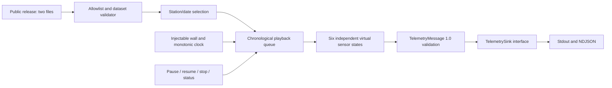

# SensorLab — Six Virtual USCRN Sensors

An independent Python 3.12+ Sensor Emulator for TSYP14, *Ground Truth Under Attack*.
SensorLab replays the existing detector release as local, versioned telemetry. It does
not import the Attack Engine or construct new perturbations.

**Current security extension:** optional Ed25519 envelopes, independent per-sensor keys,
encrypted private storage, a trusted public registry, revocation, and public-only verification.
Unsigned telemetry remains the default for compatibility; `--signed` signs every message
and fails on signing errors without falling back to unsigned output.

## Setup

From the repository root:

```bash
cd cyber-pipeline
uv sync --locked
uv run sensorlab --help
uv run sensorlab sensors list
uv run sensorlab validate
```

The default source is the local release at
`../attack-engine/datasets/generated/multivariable-20261023-seed14-acb26f07/combined/detector/`.
Generated datasets are not committed to Git. Use `--release PATH` with `validate` or
`replay` to supply a copy of this public release on another machine. Only
`detector_input.parquet` and `data_contract.json` are opened; labels are never read.

## Replay commands

```bash
uv run sensorlab replay --speed 3600
uv run sensorlab replay --speed 3600 --interactive
uv run sensorlab replay --speed 0 --output outputs/telemetry.jsonl
uv run sensorlab replay --speed 0 --start 2025-01-01T01:00:00Z --end 2025-01-02T01:00:00Z --output outputs/day.jsonl
uv run sensorlab replay --speed 60 --station AZ_Tucson_11_W --station OK_Goodwell_2_E
uv run sensorlab schema
```

| Option | Behavior |
|---|---|
| `--speed 1` | One historical hour takes one real hour |
| `--speed 60` | One historical hour takes one real minute |
| `--speed 3600` | One historical hour takes one real second |
| `--speed 0` | No deliberate waiting |
| `--station NAME` | Select a station; repeat for multiple stations |
| `--start TIMESTAMP` | Inclusive observation timestamp; explicit timezone required |
| `--end TIMESTAMP` | Exclusive observation timestamp; explicit timezone required |
| `--output FILE` | Write a new UTF-8 NDJSON file; existing files are rejected |
| `--stdout` | Also emit telemetry to stdout when using an output file |
| `--interactive` | Enable `p` pause, `r` resume, `s` status, `q` stop |

Replay starts immediately. Ctrl+C stops the run. Without `--output`, stdout contains
telemetry only. Diagnostics, interactive status, and final per-sensor counters use stderr.
Interactive input requires a TTY; on Windows keys act immediately, while Unix canonical
terminal input requires Enter. For practical interactive use, select a bounded period and
write telemetry to a file. No-wait runs may finish before a control can be entered.

Date filters apply to **observation timestamps**, not measured-hour starts. A 24-hour
selection from `2025-01-01T01:00:00Z` through, but excluding,
`2025-01-02T01:00:00Z` contains 24 observations per complete station. Historical
timestamps remain UTC interval-end timestamps. `sent_at` is a separate wall-clock UTC
timestamp captured at local transmission; it is not an ingestion acknowledgment.

## Architecture



The six sensors are independent instances of one reusable implementation, each with a
stable public ID, mapped station, next sequence, and transmission count. A session UUID is
shared by the run; each sensor starts at sequence 1. A new run creates a new session.
Global ordering is `(observation_time, station)`; a station's observations strictly increase.
Only selected stations transmit; unselected sensor counters remain zero.

Playback uses active monotonic elapsed time, excluding pauses. The first timestamp is due
immediately. Equal historical timestamps share a due time. Slow output causes later due
messages to catch up; no rows are dropped. Controls are synchronized with writes, so pause
and stop take effect between messages. Sequence counters commit only after all configured
local writes return successfully. A failed sink ends the session; automatic retries and
durable resume checkpoints are outside this implementation.

## Telemetry contract

The committed [JSON Schema](schemas/telemetry-v1.schema.json) is generated from the Pydantic
models in `src/sensorlab/telemetry.py`. Obtain it at runtime with `sensorlab schema`.

| Field | Contract |
|---|---|
| `schema_version` | `1.0` |
| `sensor_id`, `station` | Exact registered mapping; mismatches rejected |
| `session_id` | UUID identifying this replay session |
| `sequence` | Strict positive integer, increasing independently per sensor |
| `observation_time` | UTC timestamp at an exact hourly interval end |
| `sent_at` | Actual local transmission UTC timestamp |
| `measurements` | All 19 required numeric-or-null observable fields; no extra keys |

Measurement keys preserve the original names, including `SOIL_MOISTURE_5`,
`SOIL_MOISTURE_10`, and `P_CALC`, all remaining observable moisture/temperature channels,
rainfall, radiation, humidity, latitude, and longitude. The release's `partition` field is
validated as metadata but is not transmitted. Missing readings become JSON `null`;
infinite numbers and string/boolean measurement substitutes are rejected. Values are not
clipped, imputed, recalibrated, or rounded.

Input columns must exactly match the supported public allowlist in both the contract and
Parquet. Duplicate station/time keys, unknown/missing stations, invalid timestamps, and
non-numeric measurements are rejected. The entire release is validated before selection.

### Extension boundaries

`TelemetrySink.write(message)` is the extension point for future secure HTTP delivery.
`MessageSigner.sign(payload: bytes) -> bytes` is implemented by the Ed25519 signer;
`SignedTelemetrySink` adapts existing playback to signed output. Telemetry 1.0 remains
unchanged inside the versioned envelope. No HTTP client/server, AI detector, or ERA5
integration is implemented.

## Sensor identities and signed telemetry

Provision a new store from an interactive terminal; enter a strong private-key password
(at least 16 UTF-8 bytes) in the hidden prompt. Never pass passwords as command arguments.

```bash
uv run sensorlab identities provision
uv run sensorlab identities list
uv run sensorlab replay --signed --speed 3600 --start 2025-01-01T01:00:00Z --end 2025-01-02T01:00:00Z --output outputs/signed-day.jsonl
uv run sensorlab verify outputs/signed-day.jsonl --registry .sensorlab/identity/registry.json
```

Replay prompts again to unlock the encrypted keys. For noninteractive execution, supply
the password through an appropriately protected environment variable named
`SENSORLAB_KEY_PASSWORD`; `--password-env NAME` selects another variable. Do not store its
value in source files, shell command arguments, reports, or committed configuration.

The default store is:

```text
.sensorlab/identity/                 # Restricted directory; entirely Git-ignored
    registry.json                   # Public trust anchor, no private keys
    .gitignore                      # Ignores all generated store contents
    private/
        ed25519-<fingerprint>.private.pem    # Six encrypted PKCS#8 files
```

Provisioning uses secure randomness independently for each sensor and refuses to overwrite
an existing store. Directories/files use restrictive POSIX permissions; on Windows the
new identity directory has inherited ACLs removed and current-user access granted before
keys are written. OS administrator/System access is not an isolation boundary. Private
keys are encrypted with `cryptography`'s `BestAvailableEncryption` and never appear in
registry JSON, telemetry, CLI output, reports, or Git. Protect the unlock password separately.

| Command or option | Purpose |
|---|---|
| `identities provision --directory PATH` | Generate a fresh six-sensor identity store |
| `identities list --registry FILE` | Inspect public identity mappings and status |
| `replay --signed --identity-dir PATH` | Sign every replayed observation through the existing sink interface |
| `sign INPUT --output OUTPUT --identity-dir PATH` | Sign an existing unsigned NDJSON stream, preserving times, sessions, sequences and measurements |
| `verify INPUT --registry FILE` | Verify all envelopes using only trusted public keys; failures exit 1 |
| `identities revoke SENSOR_ID --registry FILE` | Mark that sensor's current key revoked for subsequent registry loads |
| `schema --signed` | Print signed envelope JSON Schema |

The signed envelope includes `envelope_version`, `algorithm`, `serialization`, `key_id`,
the entire original `telemetry`, and a base64 `signature`. All identity/session/sequence/
timestamp fields and all 19 measurements are authenticated, as are the envelope metadata.
The key ID is a SHA-256 fingerprint of the registered raw public key. Extra fields,
duplicate JSON members, unknown/mismatched identities, wrong keys and revoked keys fail.

For verification on another machine, securely distribute only the trusted **public**
`registry.json` and the signed NDJSON. No private store or password is needed. The registry
is an operator-managed trust anchor; do not accept one from an untrusted message sender.
An identical valid envelope can verify repeatedly: session authorization and network
anti-replay enforcement deliberately remain future Secure Ingestion API work. Registry
objects use a snapshot; revocation affects subsequent loads, not an already-running signer.

See the [exact signing specification](docs/SIGNED_TELEMETRY_V1.md),
[signed schema](schemas/signed-telemetry-v1.schema.json), and
[Sensor Identity report](SENSOR_IDENTITY_REPORT.md). Serialization normalizes timestamps and
uses exact binary64 hexadecimal strings in the signing representation only; transmitted
measurement values remain numeric/null. This is a documented custom format, not JCS.

## Crypto Gate (Stage 1 secure ingestion)

```bash
uv run sensorlab gate dev-cert --directory .sensorlab/tls          # localhost CA + server cert
uv run sensorlab gate authorize <UUID> --expires-at 2027-01-01T00:00:00Z   # operator-only
uv run sensorlab gate serve --cert .sensorlab/tls/server.pem --key .sensorlab/tls/server.private.pem
uv run sensorlab replay --signed --session-id <UUID> --endpoint https://127.0.0.1:8443/v1/telemetry \
    --ca-cert .sensorlab/tls/ca.pem --speed 3600 --start 2025-01-01T01:00:00Z --end 2025-01-02T01:00:00Z
uv run sensorlab gate status        # accepted/rejected counts and per-sensor state
uv run sensorlab gate events        # structured audit decisions
uv run sensorlab gate revoke-session <UUID>
uv run python scripts/validate_crypto_gate.py   # full real 24-hour HTTPS validation
```

Private-key/TLS passwords come from hidden prompts or environment variables
(`SENSORLAB_KEY_PASSWORD`, `SENSORLAB_TLS_PASSWORD`). See
[CRYPTO_GATE_REPORT.md](CRYPTO_GATE_REPORT.md) for the pipeline, results and limitations.

## Validation

```bash
uv run pytest -q
uv run ruff check .
uv run ruff format --check .
```

On machines where the system temporary directory is restricted, supply a new workspace
temporary directory: `uv run pytest -q --basetemp=.pytest-tmp-local`.

To repeat the two real CLI replays and create a new local evidence directory:

```bash
uv run python scripts/validate_real_replay.py
```

This runs the selected day at 3600× and no-wait, checks every measurement, reconciles
sequences, compares observation fingerprints, and hashes both source files before/after.

Synthetic tests always run. Real-data tests run automatically when the specified local
combined detector release exists; otherwise only those tests are skipped. They compare
observations directly with the public input, check its SHA-256, and never read ground truth.
See [SENSOR_EMULATOR_REPORT.md](SENSOR_EMULATOR_REPORT.md) for the real 24-hour replay,
artifact hashes, test results, and operational limitations.

The extended suite passed **130 tests**, including three real-data cases, with Ruff lint
and formatting checks passing. To repeat signed real-data validation with disposable,
encrypted, Git-ignored keys and a newly created output directory:

```bash
uv run python scripts/validate_sensor_identity.py
```

This validation-only driver creates a random password in process memory and child
environments, then discards it without persisting it. Those disposable private keys cannot
be unlocked afterward. Their public registry remains sufficient to verify the saved output.
For reusable identities, run `identities provision` yourself and retain the unlock password
securely. Do not use the disposable validation store as your operational identity store.
