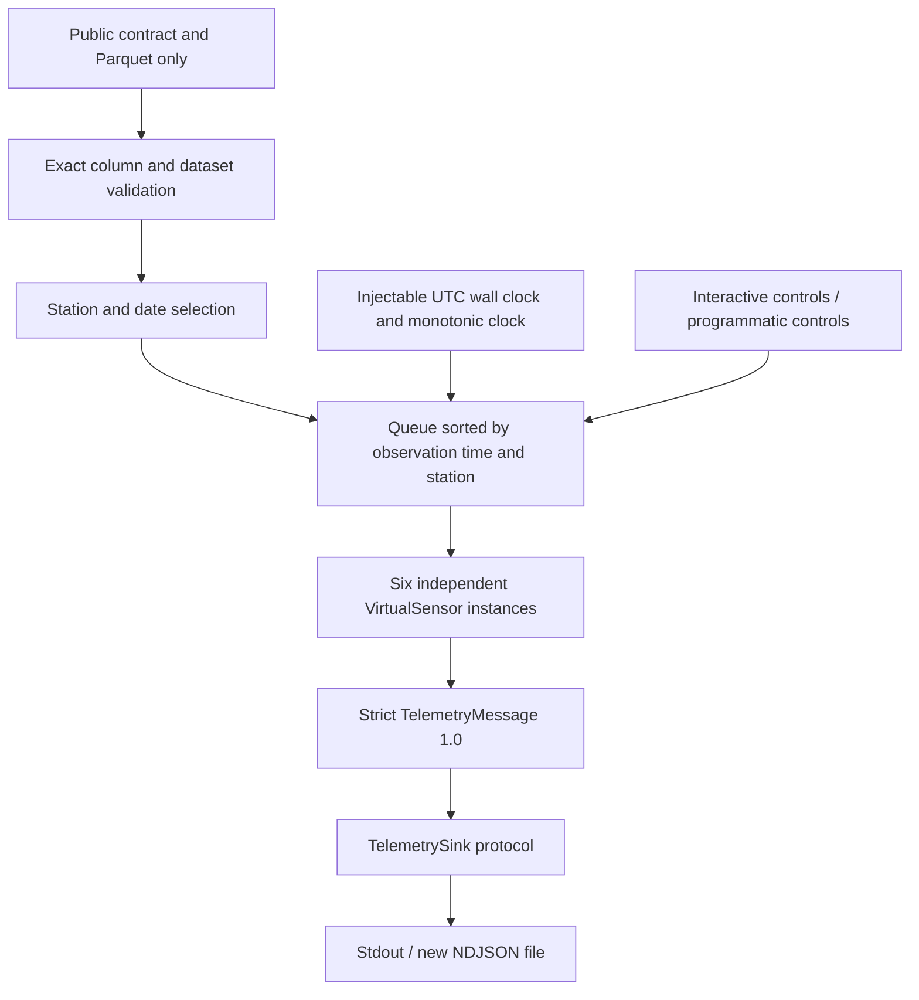

# Sensor Emulator — Six Virtual USCRN Sensors

Implemented and validated on **23 October 2026** in the independent `cyber-pipeline/`
Python 3.12+ project. The definition of done is satisfied: a selected real 24-hour period
was replayed across all six sensors, producing **144 validated telemetry messages**, with
**24 messages per sensor**, without accessing labels or evaluator artifacts.

## Scope and architecture

SensorLab consumes the existing combined campaign's public detector release. No Attack
Engine code, parameters, calibration, source delivery, or evaluator data is imported or
needed. The two input files are opened read-only:

```text
attack-engine/datasets/generated/multivariable-20261023-seed14-acb26f07/combined/detector/
    detector_input.parquet
    data_contract.json
```

The public contract documents other artifacts; that documentation does not cause them to
be opened. In particular, adjacent row/cell label files are not consumed.



| Module | Implemented responsibility |
|---|---|
| `registry.py` | Stable sensor/station mapping and explicit public measurement allowlist |
| `dataset.py` | Public contract validation, read-only loading, deterministic ordering, selection |
| `telemetry.py` | Pydantic telemetry models and generated JSON Schema |
| `sensor.py` | Per-sensor sequence state, timestamp ordering, prepare/commit checks |
| `clock.py` | Injectable wall/monotonic clock interface and real-clock implementation |
| `playback.py` | State machine, accelerated scheduling, synchronized controls and counters |
| `transport.py` | NDJSON/stdout sink, future sink and signing interfaces |
| `terminal.py` | Windows/Unix interactive controls |
| `cli.py` | Typer commands, selection, output lifecycle, diagnostics |

Dependencies are Pandas, PyArrow, Pydantic and Typer; Pytest and Ruff are development
dependencies. The environment is locked in `uv.lock` and independent of `attack-engine`.

## Six sensors

| Sensor ID | USCRN station | Messages in validated day |
|---|---|---:|
| `uscrn-az-tucson-11-w` | `AZ_Tucson_11_W` | 24 |
| `uscrn-ca-fallbrook-5-ne` | `CA_Fallbrook_5_NE` | 24 |
| `uscrn-ms-newton-5-ene` | `MS_Newton_5_ENE` | 24 |
| `uscrn-ny-ithaca-13-e` | `NY_Ithaca_13_E` | 24 |
| `uscrn-ok-goodwell-2-e` | `OK_Goodwell_2_E` | 24 |
| `uscrn-ok-goodwell-2-se` | `OK_Goodwell_2_SE` | 24 |

Six independently stateful instances reuse one sensor implementation. They share a replay
session UUID but maintain their own counters, increasing from 1 through 24 in this run.
A later run starts a new session and resets each sequence to 1. This is emulated public
identity, not authenticated or provisioned Sensor Identity.

## Telemetry contract and security boundary

[telemetry-v1.schema.json](schemas/telemetry-v1.schema.json) is generated from the runtime
Pydantic model. The automated suite checks that the committed schema matches the model.

Every message includes the explicit version `1.0`, `sensor_id`, `station`, `session_id`,
positive integer `sequence`, `observation_time`, `sent_at`, and `measurements`.

- Sensor/station pairs must match the registry; unknown identities and mismatches fail.
- `observation_time` retains the historical UTC timestamp at the exact end of an hour.
- `sent_at` uses the injected clock's actual UTC wall time at local emission. Playback
  timing itself uses monotonic elapsed time, excluding pauses.
- All 19 measurement keys are required, numeric or null. Extra envelope/measurement keys,
  booleans or strings in place of measurements, infinity, invalid UUIDs, missing versions,
  non-UTC/naive timestamps, epoch-number timestamp substitutes, and invalid sequences fail.
- Missing values become JSON `null`; measurements are not clipped, rounded, recalibrated,
  imputed, or otherwise modified.
- `partition` is validated as public dataset metadata and excluded from telemetry. No attack
  ID, family, clean reference, evaluability label, or other privileged annotation is emitted.

The loader requires the exact supported 22 public input columns in both the contract and
Parquet. Adding an extra column, even by editing the contract, fails the allowlist check.
It validates station inventory, unique keys, hourly timestamps, numeric types and finite-or-
missing measurements before selecting a period. It does not impose new physical bounds on
already-exported observations.

`TelemetrySink.write(message)` provides the future transport boundary.
`MessageSigner.sign(payload)` is a protocol declaration only. No signing implementation,
keys, HTTP client/server, secure identities, AI detector, or ERA5 integration was added.
Current telemetry is unsigned and local.

## Playback and CLI

From `cyber-pipeline/`:

```bash
uv sync --locked
uv run sensorlab sensors list
uv run sensorlab validate
uv run sensorlab schema
uv run sensorlab replay --speed 3600
uv run sensorlab replay --speed 3600 --interactive
uv run sensorlab replay --speed 0 --output outputs/telemetry.jsonl
```

The exact real-day command is:

```bash
uv run sensorlab replay --speed 3600 --start 2025-01-01T01:00:00Z --end 2025-01-02T01:00:00Z --output outputs/day.jsonl
```

Use a new output filename each time. `--release PATH` overrides the default detector
release. Repeat `--station NAME` to select stations. Date filters are **inclusive start,
exclusive end on observation timestamps** and require explicit timezone offsets.

| Speed | Mapping of one historical hour |
|---|---|
| `1` | One real hour |
| `60` | One real minute |
| `3600` | One real second |
| `0` | No deliberate waiting |

Other finite positive factors are accepted. Negative/non-finite speeds fail. The first
historical timestamp is transmitted immediately; a 24-observation station spans 23 hourly
gaps, so this selection takes approximately 23 playback seconds at 3600×, plus startup.

Interactive controls are `p` pause, `r` resume, `s` status, and `q` stop; Ctrl+C also stops.
Windows keys act directly. Unix canonical terminal input requires Enter. Non-TTY interactive
requests fail explicitly. Status/final counters use stderr; stdout remains an NDJSON stream.
With `--output`, stdout is silent unless `--stdout` explicitly mirrors the output.

Playback states are `ready`, `running`, `paused`, `stopped`, `completed`, and `failed`.
Pause/resume/stop/status methods are thread-safe; a condition lock synchronizes transitions
with message writes. Each row is held until emitted or stopped. Pause time is removed from
the scheduling clock, so resume does not skip rows or rush through paused historical time.
Per-sensor status includes selection, state, count, next sequence, and last observation.

Counters commit after successful local writes. Sink exceptions end the run in `failed`.
An engine instance can run once; stopped sessions are not silently restarted.

## Real dataset validation and results

Full public-input validation processed **210,384 rows**, **35,064 per station**, covering
`2022-01-01T01:00:00Z` through `2026-01-01T00:00:00Z`. All 19 observable environmental
variables are retained, including the three multi-variable attack targets. The source has
5,401 missing 5 cm moisture readings, 5,335 missing 10 cm readings, and 1,446 missing rainfall
readings; the full-stream test checked missingness across all 19 fields.

The selected real period was:

```text
2025-01-01T01:00:00Z <= observation_time < 2025-01-02T01:00:00Z
```

It contains 144 observations, 24 per sensor, and **288 null measurement cells**. Every
serialized message was reopened, validated, and compared with the corresponding public
observation. Values and observation order matched exactly.

| Run | Messages | Per sensor | CLI wall time | First-to-last sent_at span | Result |
|---|---:|---:|---:|---:|---|
| Actual CLI, 3600× | 144 | 24 | 24.843 s | 22.989106 s | Completed |
| Actual CLI, no-wait | 144 | 24 | 1.859 s | 0.007768 s | Completed |
| Live Windows interactive, 3600× | 144 | 24 | Includes operator pause | 36.718181 s | Completed |

The live terminal run accepted `p`, remained at **66 transmitted messages** when queried
with `s`, and accepted `r`. It then completed with sequences 1–24 for each sensor, with no
duplicate or missing identities. Its observation fingerprint matched both noninteractive
runs. This manually exercised the real terminal adapter in addition to automated control
and clock tests.

### Output paths

Local artifacts, relative to `cyber-pipeline/`:

```text
outputs/validation-20261023T184719Z-b9347be0/
    telemetry-speed3600.jsonl
    telemetry-speed0.jsonl
    validation.json
outputs/interactive-24h.jsonl
```

`outputs/` is git-ignored. Repository-visible evidence is recorded in
[validation/sensor_emulator_results.json](validation/sensor_emulator_results.json), including
source hashes before/after, selection, counts, timing, output hashes, and interactive results.

| Artifact | SHA-256 |
|---|---|
| Input `detector_input.parquet`, before and after | `ff478b38f2f0996b5301a48f93f0a4b0a40b7bc321440c69f8e85ff31c6eb50a` |
| Input `data_contract.json`, before and after | `bbee3a7343a0abc4c15223fd96051c41b5d8dfb6c4281a55e09c4a6c3b82c8dd` |
| 3600× NDJSON | `28ce58f8db0819601e6e9634bab81233855a3d0b25359a6de194bcaf0fc79eff` |
| No-wait NDJSON | `43a604f5b6597a0bae39d9e3ce44b6ca838df378abed9724a71db27af71e0d00` |
| Interactive NDJSON | `a0688b1d3e8fad0951dbf1e33dbe3e4acf2534547ec4ce1fc4bdd80294faa00f` |
| Telemetry JSON Schema | `bb283e98d191a10ca4863deafa3b1f1e7f1300de4fbde471e9cc76d0e0c7caec` |

All three runs have the same stable observation fingerprint:

`f410549258e66c28fccc6d4aa260ccfbf3e3a831061af2fc1976a364ea7fb537`

The fingerprint hashes sorted compact JSON for the ordered messages excluding only
`session_id` and `sent_at`. Output bytes intentionally differ across sessions because those
fields represent actual executions. Injecting a fixed session and clock also produces
byte-identical telemetry in the synthetic reproducibility test.

## Automated tests and quality checks

Final result: **62 tests passed, zero skipped**, in **9.67 seconds**. This includes two real
dataset integration tests. Ruff lint and formatting checks passed for the source, tests,
validation driver, and project configuration. `uv lock --check` passed, and `uv build`
successfully produced both a source distribution and a wheel in the ignored `dist/` directory.

```bash
uv run pytest -q --basetemp=.pytest-tmp-final --tb=short
uv run ruff check .
uv run ruff format --check .
```

The explicit workspace test directory avoids this machine's restricted system temporary
directory. Use a new directory name when repeating validation in a restricted environment.

Coverage includes six independent sensors, exact ordering and timestamps, per-sensor
sequences, all playback speeds with an injected clock, pause/resume without loss, stop
during emission/pause/long waits, sink failure accounting, source overwrite prevention,
null preservation, strict telemetry validation, allowlist rejection of labels/extra fields,
station/date selection, stdout/file mirroring, and JSON Schema consistency.

Real tests run automatically when the local public release exists, otherwise only those
two tests skip. To repeat the actual timed and no-wait CLI validation into a new directory:

```bash
uv run python scripts/validate_real_replay.py
```

The Attack Engine implementation, datasets and prior exports were not edited. Its existing
544-test validation remains separately documented; this task ran the independent SensorLab
suite rather than rerunning the unchanged Attack Engine suite.

## Limitations and stopping point

- This is historical, local emulation. Sensors have independent state but use one ordered
  execution loop, not six processes or physical devices.
- The loader validates and holds the full public release in memory. It supports the current
  six-station, 19-measurement contract; additional station/column schemas require an explicit
  registry/contract update. Gaps retain their actual elapsed duration rather than fabricating rows.
- Scheduling is best-effort, not hard real-time. System load and sink latency can delay messages;
  overdue messages are sent in order. Wall-clock adjustments can affect `sent_at`, while monotonic
  pacing remains separate. Controls take effect between writes; a blocked sink can delay them.
- A failed/interrupted write may leave a partial final NDJSON line. Multi-output writes are not
  transactional; one stream can succeed before another fails. There are no network acknowledgments,
  retries, persistent checkpoints, cross-session sequence persistence, or exactly-once guarantees.
- Output files use exclusive creation and never replace existing files. The default dataset path
  assumes the source checkout layout; installed deployments should pass `--release` explicitly.
- The detector release and telemetry outputs are local generated artifacts and are not committed.
  The Windows terminal adapter was exercised live; the Unix adapter is implemented but was not
  exercised in a Unix terminal on this machine.

Implementation stops at Sensor Emulator generation and validation. Sensor Identity, Ed25519
cryptography, Secure Ingestion API, AI integration, and ERA5 remain unimplemented.
