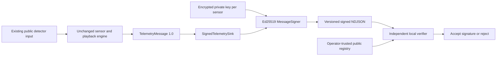

# Sensor Identity and Ed25519 Signing

Completed **23 October 2026**, extending the existing SensorLab emulator in place. The
definition of done is satisfied: **144 messages** from the real 24-hour combined USCRN
release were signed and verified using six independent sensor identities. Modifying a
signed measurement caused Ed25519 verification to fail.

## Architecture and compatibility

The existing dataset loader, sensor instances, clock, playback loop, and telemetry 1.0
model are reused. `MessageSigner` is implemented by `Ed25519Signer`; the
`SignedTelemetrySink` adapter wraps each original `TelemetryMessage` in a signed envelope.
The existing NDJSON sink writes either model without changing playback accounting.



| Component | Implementation |
|---|---|
| `identity.py` | Six-key provisioning, public registry, encrypted loading, fingerprint checks, revocation |
| `identity_cli.py` | Hidden password handling and local identity administration |
| `wire.py` | Duplicate-rejecting JSON parsing and strict canonical base64 |
| `signing.py` | Deterministic serialization, Ed25519 signing, signed sink, public-only verification |
| `cli.py` | Signed replay, offline signing, local verification, signed schema output |
| `docs/SIGNED_TELEMETRY_V1.md` | Exact envelope, serialization and trust specification |

Unsigned output remains the default, retaining the original format and commands. Opting
into `--signed` signs **every** emitted observation and fails closed on any key/signature
error. There is no unsigned fallback. Existing timestamp, value, selection, playback-speed,
pause/resume/stop, counters, stdout and file-output behavior remains available.

`cryptography==50.0.2` is recorded in the independent `uv.lock`. No Attack Engine files,
exported datasets, calibration, or attack parameters were changed.

## Provisioning and trust

`Ed25519PrivateKey.generate()` generates a fresh, independent key for each of the six
registered sensors using the library's secure random generation. Every registry entry has:

- The stable `sensor_id` and its exact `station` mapping.
- `key_id = "ed25519-" + SHA256(raw_public_key).hexdigest()`.
- A canonical base64-encoded, raw 32-byte Ed25519 public key.
- Status `active` or `revoked`.

The strict registry model requires exactly six known mappings and six distinct key IDs;
public-key fingerprints must match their key IDs. Verification uses only this trusted
registry, never a message-supplied public key. The public registry must be distributed by
the operator through a trusted channel and protected against unauthorized edits.

### Private-key storage

Private keys are serialized as **encrypted PKCS#8 PEM** using
`serialization.BestAvailableEncryption(password)`. Provisioning requires a password of at
least 16 UTF-8 bytes, taken from a hidden terminal prompt or a named environment variable.
Passwords are not accepted as command-line values and are not written into artifacts.

- Default location: `.sensorlab/identity/private/<key_id>.private.pem`.
- `.sensorlab/` and `*.private.pem` are Git-ignored; each generated store also contains an
  ignore-all `.gitignore`, including when a custom directory is used.
- Root creation and key files are exclusive; existing stores/files are never overwritten.
- POSIX directories/files use `0700`/`0600`, with owner/mode checks before private loading.
- On Windows, provisioning removes inherited ACLs and grants current-user access before
  writing keys. The live store ACL was inspected: current user, SYSTEM, Administrators,
  and OWNER RIGHTS had access; no broad Users/Everyone entry was present. Administrator
  takeover is outside this local isolation boundary.
- Symlink/junction key-store paths are rejected. Key loading verifies that the decrypted
  Ed25519 public key matches the trusted registry. Errors do not include passwords or key bytes.

Verification needs neither the password nor any private key file. The validation driver
used a disposable encrypted store with a random process-local password; it intentionally
discarded that password rather than persisting a recovery secret. The corresponding public
registry remains sufficient to verify the recorded messages. Operators should provision a
separate reusable store and retain its unlock password securely.

## Signed telemetry contract

The envelope version is `1.0`, algorithm `Ed25519`, and serialization identifier
`sensorlab-c14n-1`. It includes `key_id`, the entire original telemetry object, and a
canonical base64-encoded 64-byte signature. No private or public key is embedded.

The signature authenticates:

| Authenticated data | Included |
|---|---|
| Envelope version, algorithm, serialization, key ID | Yes |
| Telemetry schema version, sensor ID, station | Yes |
| Session UUID and per-sensor sequence | Yes |
| Historical observation timestamp and actual transmission timestamp | Yes |
| Every one of the 19 named measurements, including nulls | Yes |

Signing bytes use a fixed domain prefix followed by sorted compact ASCII JSON. Timestamps
normalize to UTC with six fractional digits. Measurement numbers become exact binary64
hexadecimal strings **in the signing representation only**; telemetry retains numeric/null
values. This avoids reliance on decimal float formatting and distinguishes `0.0`, `-0.0`,
and missing values. The format is explicitly custom, not RFC 8785/JCS.

The verifier strictly parses, validates, checks active trusted identity/key status,
reconstructs those bytes and calls `Ed25519PublicKey.verify`. Ambiguous duplicate members,
extra fields, malformed/short signatures, non-finite measurements, wrong identities/keys,
and revoked keys fail. Semantically equivalent JSON whitespace/member order, UUID spelling,
or UTC timestamp precision may normalize to identical bytes; these are representation
differences, not authenticated-value changes.

Exact documentation and schemas:

- [Signing specification](docs/SIGNED_TELEMETRY_V1.md)
- [Signed envelope JSON Schema](schemas/signed-telemetry-v1.schema.json)
- [Trusted registry JSON Schema](schemas/sensor-registry-v1.schema.json)
- [Public interoperability vector](validation/signed-telemetry-v1-vector.json)

The vector contains only a public key, the complete signed envelope, and the exact signing
bytes in base64. An automated test verifies it directly with `cryptography`, independently
of the SensorLab signing service. The RFC 8032 public-key/signature test vector is also
checked without including its private seed in the repository.

## Commands

From `cyber-pipeline`, use a terminal for hidden password prompts:

```bash
uv sync --locked
uv run sensorlab identities provision
uv run sensorlab identities list
uv run sensorlab replay --signed --speed 3600 --start 2025-01-01T01:00:00Z --end 2025-01-02T01:00:00Z --output outputs/signed-day.jsonl
uv run sensorlab verify outputs/signed-day.jsonl --registry .sensorlab/identity/registry.json
uv run sensorlab schema --signed
```

For existing unsigned telemetry and local revocation:

```bash
uv run sensorlab sign outputs/day.jsonl --output outputs/day-signed.jsonl
uv run sensorlab identities revoke uscrn-az-tucson-11-w --registry .sensorlab/identity/registry.json
```

Revoking that key causes subsequent verification under the updated registry to reject its
envelopes, including older envelopes. Output filenames and identity stores must be new.
Use `--identity-dir PATH` or provisioning's `--directory PATH` for non-default storage.

Automation can supply `SENSORLAB_KEY_PASSWORD` through its protected process environment;
`--password-env NAME` selects another environment variable. Verification does not need one.
Never put real passwords in scripts, terminal command arguments, reports, or Git.

Repeat the complete real validation with new disposable keys and output paths:

```bash
uv run python scripts/validate_sensor_identity.py
```

## Real-USCRN validation

Only the existing combined release's `detector_input.parquet` and `data_contract.json`
were read as dataset inputs. No ground truth, labels, manifest, evaluator data, or clean
source values were accessed.

| Property | Result |
|---|---|
| Observation period | `2025-01-01T01:00:00Z` inclusive to `2025-01-02T01:00:00Z` exclusive |
| Sensors | All six |
| Messages generated / verified | **144 / 144** |
| Per-sensor messages and sequences | 24 each; sequences 1–24 |
| Preserved measurements | All 19, compared directly with public input |
| Missing measurement cells | 288 JSON nulls |
| Playback speed | 3600× |
| CLI elapsed time including startup/unlock | 24.984 seconds |
| First-to-last `sent_at` span | 22.999879 seconds |
| Modified signed 5 cm measurement | Rejected: `invalid Ed25519 signature`, exit 1 |
| Revoked public registry entry | Rejected: `sensor key is revoked`, exit 1 |
| Public-only verification | Separate CLI process, no password, no private directory in working directory |
| Source integrity | Both public input hashes unchanged |

Local output directory:

```text
outputs/identity-20261023T190838Z-6618b4e0/
    signed-24h.jsonl
    trusted_registry.json
    tampered-measurement.jsonl
    revoked_registry.json
    verification-vector.json
    validation.json
```

The disposable encrypted keys remain under the corresponding `.sensorlab/identity-.../`
directory. Neither the keys nor output directory is included in Git. Public evidence is
in [sensor_identity_results.json](validation/sensor_identity_results.json).

| Artifact | SHA-256 |
|---|---|
| Public input Parquet, before and after | `ff478b38f2f0996b5301a48f93f0a4b0a40b7bc321440c69f8e85ff31c6eb50a` |
| Public input contract, before and after | `bbee3a7343a0abc4c15223fd96051c41b5d8dfb6c4281a55e09c4a6c3b82c8dd` |
| Signed 24-hour NDJSON | `b7b74ca33f4c1b2041215632efbffa2941503ea6ac0ee5b0424d201332932cdb` |
| Trusted public registry copy | `28abf4ae6f9b2c83fc98b31787f44cdaff43c40aab7b89519f4a65750a67a5b8` |
| Tampered measurement file | `e6c0736d811ab5bad98de79a621218f90eccad28b1bd7beac0cc542a81fed6c0` |
| Public verification vector | `2c0b5d68b0f53d135d867ffc5f615d456567d95f69f41b6854d973353e75a950` |

Different provisionings deliberately produce different key pairs. Session UUIDs and actual
`sent_at` timestamps also vary across live runs, so full signed-file hashes are run-specific.
For the same key and exact normalized message, Ed25519 signatures are deterministic; this
is tested. The committed public vector fixes a reproducible verification example.

## Tests and checks

**130 tests passed, zero skipped, in 13.50 seconds**, including three real-data tests.
All 62 original emulator tests remain passing. Ruff lint and formatting checks passed.

```bash
uv run pytest -q --basetemp=.pytest-tmp-identity-final --tb=short
uv run ruff check .
uv run ruff format --check .
```

New coverage includes independent random keys, encrypted storage/password failures, no
overwrite, registry validation, sensor/station and fingerprint matching, key revocation,
direct public-key verification, deterministic signatures, every measurement and metadata
field tampered independently, unknown sensors, wrong signing adapters, duplicate/invalid
JSON, nulls and signed zero, schema consistency, CLI sign/verify, and real 144-message replay.

The explicit workspace test directory avoids this machine's restricted system temp folder.
No unchanged Attack Engine tests were rerun; its prior results remain separately documented.

## Limitations and stopping point

- Registry trust is local and operator-managed; the registry is not self-authenticating.
  Administrators and the signing process can access unlocked keys. This is encrypted local
  storage, not a TPM/HSM, remote attestation, or physical device identity.
- Keys are unlocked into process memory for signing. Python does not guarantee memory
  zeroization; process/environment hygiene and password retention remain operator duties.
- Registry status is a snapshot per load. Hot revocation propagation, rotation history,
  certificate lifecycles, and multiple simultaneously valid keys per sensor are not implemented.
- Verification proves the registered key signed the bound values; it does not establish
  that the environmental values are genuine or free of the existing FDI modifications.
- Verification is stateless and deliberately accepts repeated valid envelopes. Session
  authorization, replay ledgers, receive-time policies and network anti-replay checks are
  reserved for the future Secure Ingestion API.
- Local output retains the emulator's partial-file/multi-sink failure limitations. Signing
  does not add transactional delivery, persistent sequence state, or network acknowledgments.
- Provisioning failures can leave a restricted partial store. Provision again into a new
  directory; existing key material is never overwritten or silently regenerated.
- The live storage/CLI checks ran on Windows; POSIX permissions are implemented and tested
  conditionally when running on POSIX, but were not exercised on a POSIX host in this run.

No FastAPI service, network ingestion, AI integration, ERA5, or dashboard was implemented.
Work stops after Sensor Identity/signing implementation and validation.

API references: [cryptography Ed25519 documentation](https://cryptography.io/en/latest/hazmat/primitives/asymmetric/ed25519/)
and [RFC 8032 public test vectors](https://www.rfc-editor.org/rfc/rfc8032#section-7.1).
